<h1 align="center">O3-VOC03ER</h1>

<p align="center"><b>Turn the Tracker into a vocoder and talkbox: speak, sing or sample into it, and play the voice through chords from the 48 pads.</b></p>

<p align="center">
  <a href="https://github.com/trak3r-os/o3-voc03er/releases"></a>
  <a href="docs/MANUAL.md"></a>
  <a href="docs/CHANGELOG.md"></a>
  <a href="LICENSE"></a>
  <a href="https://github.com/trak3r-os/o3-sdk"></a>
  
  
</p>

<p align="center">
  <a href="https://github.com/trak3r-os/o3-voc03er/releases"><b>Download</b></a> ·
  <a href="docs/MANUAL.md"><b>Manual</b></a> ·
  <a href="docs/MANUAL.md#3-the-first-five-minutes"><b>First five minutes</b></a> ·
  <a href="docs/CHANGELOG.md"><b>What's new</b></a> ·
  <a href="#build"><b>Build it</b></a>
</p>

<p align="center">
  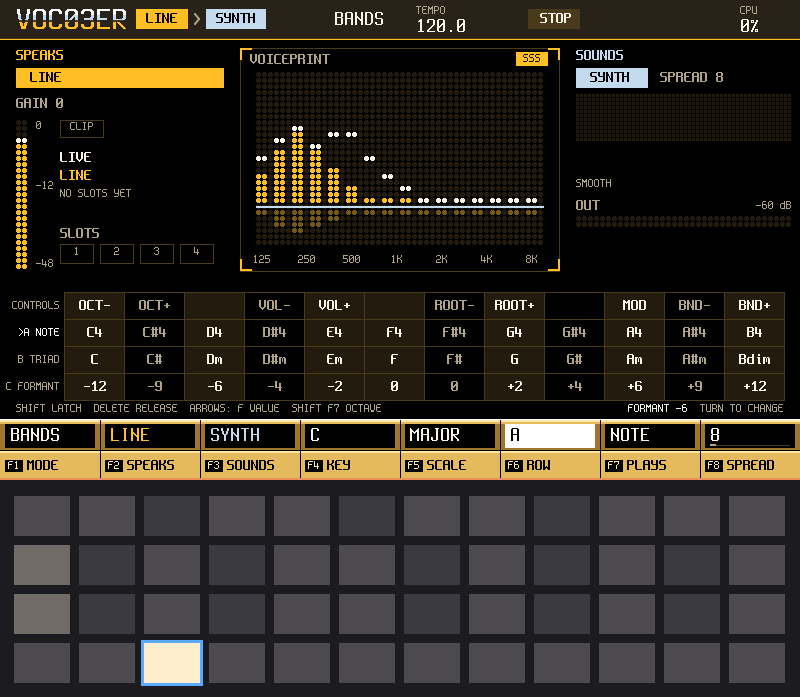
</p>

> **Unofficial.** O3-VOC03ER is not affiliated with or endorsed by Polyend. "Tracker" is used only to describe the hardware it runs on.
> It is a whole firmware: it replaces the unit's own software while it is installed, so back up your card first.

## What is it?

One instrument with one idea: a voice (SPEAKS) is turned into a voiceprint, and the voiceprint shapes a sound (SOUNDS). You keep the hardware
you know, the pads, the buttons, the encoder and the screen, and they all become the vocoder.

- **Five modes.** BANDS, a 16-band channel vocoder. TALK, an LPC talkbox. TUNE, pitch correction with a key and a scale to snap to.
  ROBOT, the bands with a fast compressor. TRACT, a model of a vocal tract after the carrier: nothing is analysed, you shape the vowel,
  the jaw and the lips with your hands, and a MOUTH lane in the pattern writes them. It needs more testing.
- **Sources.** The line input, the microphone, USB audio, the radio, and samples, on either side of the vocoder: a sample can speak, or
  be the sound that is spoken through.
- **A carrier synth inside.** Eight voices with SHAPE, SPREAD, SUB, TILT and NOISE. The 48 pads play chords: twelve roots, with triad,
  seventh, open and power rows and four voicings (CLOSE, OPEN, WIDE, SMOOTH), or plain keys, and a bend row.
- **Four sample slots** of 16 s each, with up to 24 slices per slot, edited on the unit.
- **A step sequencer.** Eight patterns of 1 to 16 steps with NOTE, CARRIER, LEVEL, SLICE and MOUTH lanes, and a SONG that chains them.
- **MIDI in.** Notes, pitch bend, program change (it picks the pattern) and clock.
- **Projects** that you save to the card, with the samples as WAVs.

## The screens

<table>
  <tr>
    <td><a href="docs/MANUAL.md">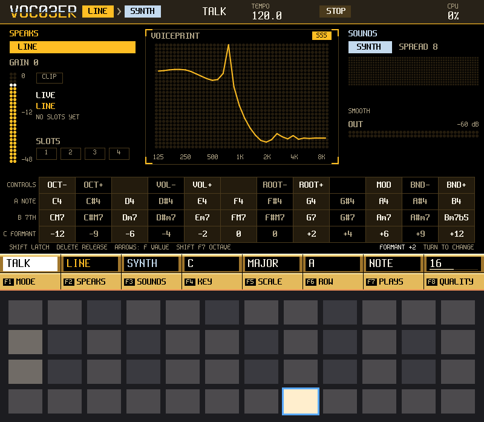</a></td>
    <td><a href="docs/MANUAL.md">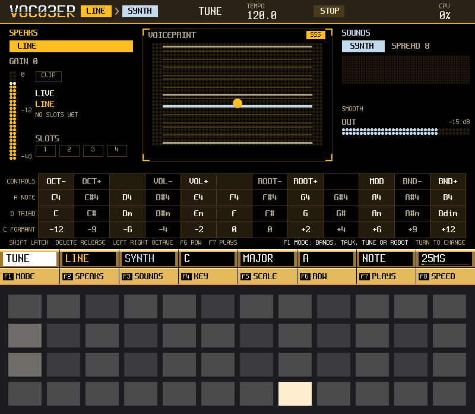</a></td>
  </tr>
  <tr>
    <td align="center"><b>PERFORM, TALK</b>: the talkbox, played from the pads</td>
    <td align="center"><b>PERFORM, TUNE</b>: pitch correction to a key and scale</td>
  </tr>
  <tr>
    <td><a href="docs/MANUAL.md">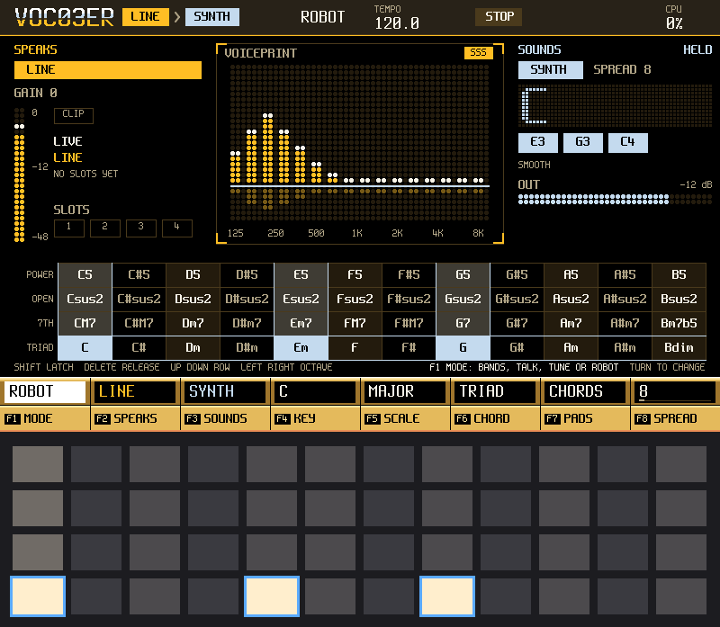</a></td>
    <td><a href="docs/MANUAL.md">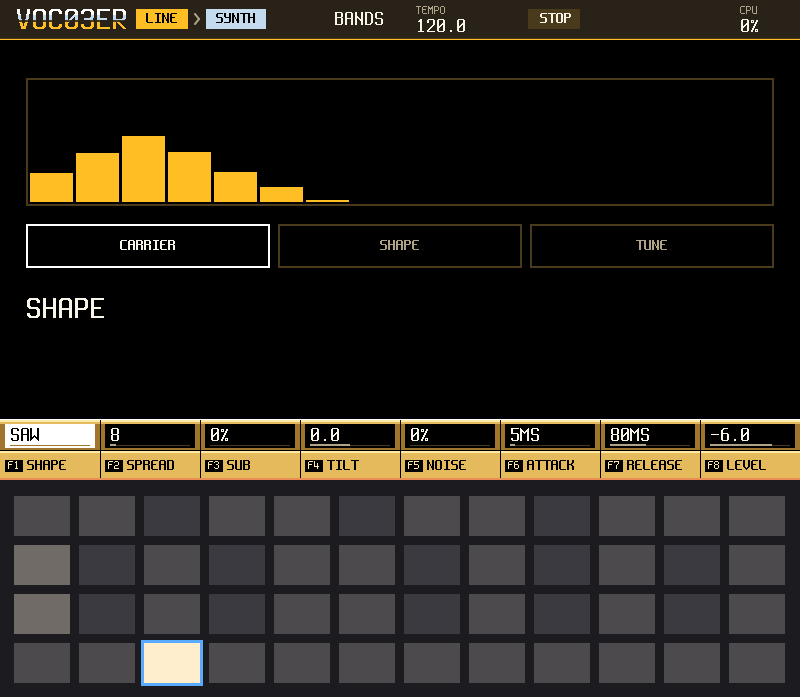</a></td>
  </tr>
  <tr>
    <td align="center"><b>ROBOT</b>: the bands, compressed and flat</td>
    <td align="center"><b>PARAMS</b>: the knobs of the voice and the carrier</td>
  </tr>
  <tr>
    <td><a href="docs/MANUAL.md">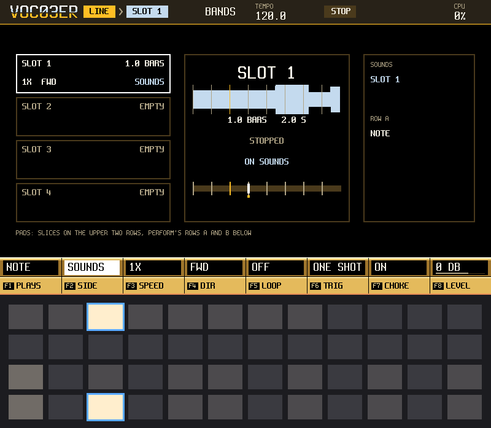</a></td>
    <td><a href="docs/MANUAL.md">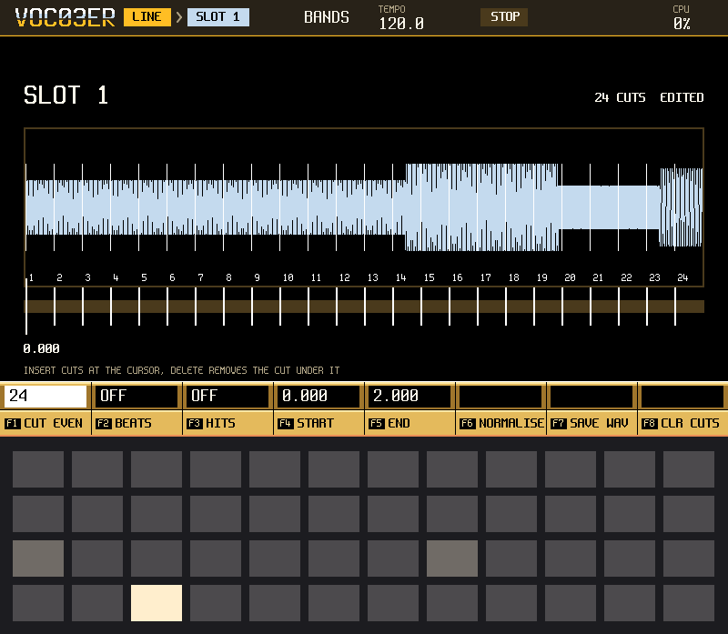</a></td>
  </tr>
  <tr>
    <td align="center"><b>SAMPLE</b>: four slots, with slices</td>
    <td align="center"><b>SAMPLE EDIT</b>: trim, speed, direction and slices</td>
  </tr>
  <tr>
    <td><a href="docs/MANUAL.md">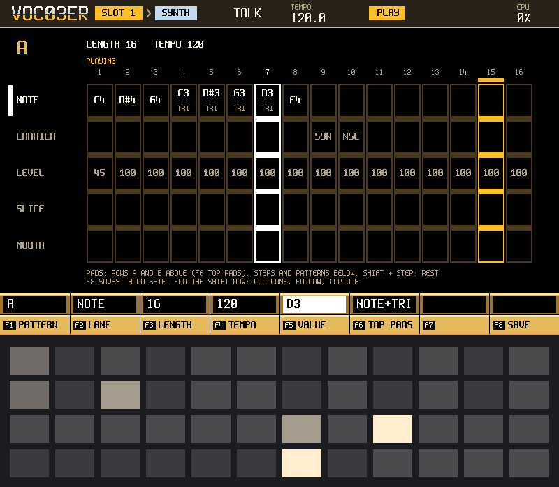</a></td>
    <td><a href="docs/MANUAL.md">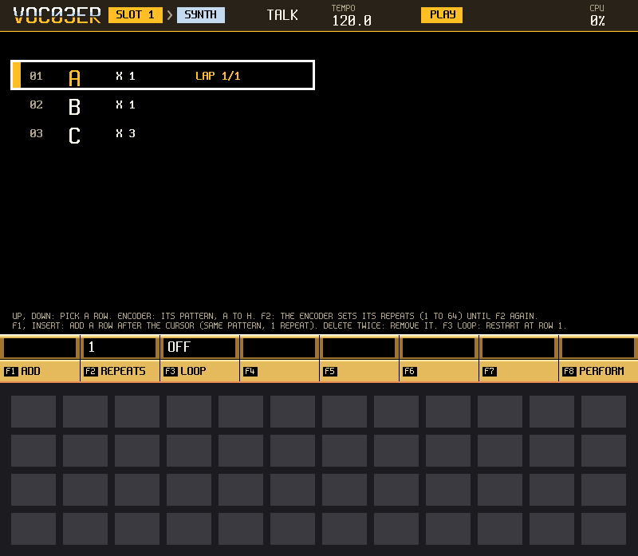</a></td>
  </tr>
  <tr>
    <td align="center"><b>PATTERN</b>: eight patterns, five lanes</td>
    <td align="center"><b>SONG</b>: patterns in order, with repeats</td>
  </tr>
  <tr>
    <td><a href="docs/MANUAL.md">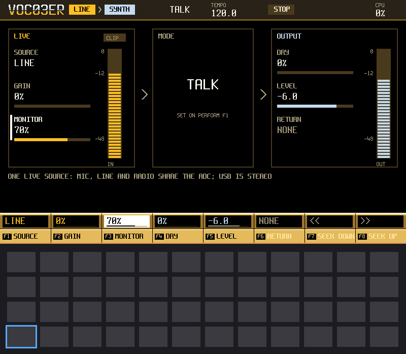</a></td>
    <td><a href="docs/MANUAL.md">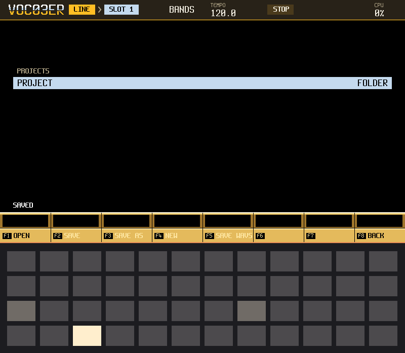</a></td>
  </tr>
  <tr>
    <td align="center"><b>MASTER</b>: tempo, clock and the meters</td>
    <td align="center"><b>FILE</b>: projects and WAVs on the card</td>
  </tr>
</table>

The pictures come from the simulator, which draws the same screens as the unit. Click one for the manual.

## Get it on your Tracker

1. **Download** `o3_voc03er-<version>.ptf` and `SHA256SUMS` from the [releases](https://github.com/trak3r-os/o3-voc03er/releases) page, and
   check the download with `sha256sum -c SHA256SUMS`.
2. **Back up** the whole SD card, and keep the firmware you run now on your computer: that is your way back.
3. **Install** it from the card with the unit's hidden reset button, or over USB from a firmware with the console.
   [Section 2 of the manual](docs/MANUAL.md#2-install-it-and-go-back-to-the-stock-firmware) has every step, and how to go back.

Then read [the first five minutes](docs/MANUAL.md#3-the-first-five-minutes). After that you can stop reading and play.

## Status

This is a pre-release (v0.2.0), and it needs more testing. What a unit has shown so far (`docs/PLAN.md`, sections 4 to 4l): the render
stays under its CPU limit with no underruns on the readings taken, with BANDS, eight carrier notes and four loops running; a project saves
and loads again on the unit, samples included; and MIDI over USB works. What has not been tried on a unit is listed in
[the changelog](docs/CHANGELOG.md). A host test is not a test on the unit, and the sound is judged by ear on the unit.

## Build

No unit is needed for the first part: the simulator runs the app on a computer, and writes the screens as PNG and the sound as WAV.

The two repositories side by side (o3-sdk next to this directory, `-DO3SDK_DIR=<path>` or `$O3SDK_DIR` otherwise):

```sh
git clone https://github.com/trak3r-os/o3-sdk.git
git clone https://github.com/trak3r-os/o3-voc03er.git
cd o3-voc03er
```

The host build needs CMake 3.24 or newer and a C++17 compiler; the image needs the ARM GNU toolchain 15.3.rel1.

```sh
cmake -S . -B build-host
cmake --build build-host -j4
ctest --test-dir build-host --output-on-failure

# the app in the simulator: PNG snapshots of the screen and the pads, and the audio as a WAV
mkdir -p /tmp/o3_voc03er
build-host/app/o3_voc03er_sim --scenario app/scenarios/boot.txt --out /tmp/o3_voc03er

# the firmware image: build-mk66/app/o3_voc03er.ptf
cmake -S . -B build-mk66 -DO3SDK_PLATFORM=mk66 -DARM_GNU_ROOT=<arm-gnu-toolchain-15.3.rel1 dir>
cmake --build build-mk66 -j4
ctest --test-dir build-mk66 -L mk66 --output-on-failure   # the image's static checks

tools/ci.sh host          # a fresh build, warnings, ctest, sizes
tools/ci.sh mk66          # the same for the image, and no software double helpers
python3 -I tools/gate.py o3_voc03er --host-build build-host   # the release gate's mechanical half
```

The licence is GPL-3.0-or-later because the image links the GPL kit statically.

## Layout

`app/` the app, its screens, skins and scenarios · `units/vocoder/` the DSP unit (the bands, the talkbox, the pitch corrector, the carrier
synth and the loops) · `tests/` host tests · `docs/` the manual, the screens' design, the plan and the research notes in `docs/ports/` ·
`tools/` the CI and the release gate · `.claude/` the agent harness, from o3-sdk. Start with [CLAUDE.md](CLAUDE.md).

## Credits and licence

The talkbox follows the DSP steps of [mda Talkbox](https://sourceforge.net/p/mda-vst/code/HEAD/tree/) by Paul Kellett (MIT option), written
here as a streaming design. The pitch detector is written from the YIN paper (de Cheveigne and Kawahara, 2002); the other engines are original
code. [THIRD_PARTY.md](THIRD_PARTY.md) has the full list.

O3-VOC03ER is GPL-3.0-or-later ([LICENSE](LICENSE)).
