# O3-VOC03ER player's manual

O3-VOC03ER turns the Tracker into a voice machine. Your voice, or a recording, shapes a synth you play with the 48 pads: a vocoder, a
talkbox, a pitch corrector and a robot voice in one instrument, with a sampler, a step sequencer and a song chain beside it. This manual
starts with what makes sound fastest and goes deeper as it goes on. You can stop reading after section 3 and play.

The pictures come from the O3-VOC03ER simulator, which draws the same screens as the unit. Where a picture also shows the pads, the grid
under the screen is the simulator's drawing of the pad lights. The simulator is fed plain tones for a voice, so the voiceprint in the
pictures is thinner than a real voice would make it.

> **Unofficial.** O3-VOC03ER is not affiliated with or endorsed by Polyend. "Tracker" is used only to describe the hardware it runs on.

## Contents

1. [What O3-VOC03ER is](#1-what-o3-voc03er-is)
2. [Install it, and go back to the stock firmware](#2-install-it-and-go-back-to-the-stock-firmware)
3. [The first five minutes](#3-the-first-five-minutes)
4. [The screens, one by one](#4-the-screens-one-by-one)
5. [The four modes](#5-the-four-modes)
6. [Samples and slices](#6-samples-and-slices)
7. [Patterns and songs](#7-patterns-and-songs)
8. [MIDI](#8-midi)
9. [Projects and the card](#9-projects-and-the-card)
10. [Known limits, and what needs more testing](#10-known-limits-and-what-needs-more-testing)

## 1. What O3-VOC03ER is

O3-VOC03ER is a whole firmware for the Tracker hardware. It replaces the Tracker's own software while it is installed (section 2 says how
to go back). It is one instrument built on one idea: **something speaks, something sounds.**

- **SPEAKS** is the voice: a microphone, a line input, the radio, USB audio, or a recording in one of four slots.
- **SOUNDS** is what that voice plays through: a synth, noise, the live input, or a recording.
- In the middle is the **voiceprint**: sixteen bars that show, live, the shape of the voice that is speaking.

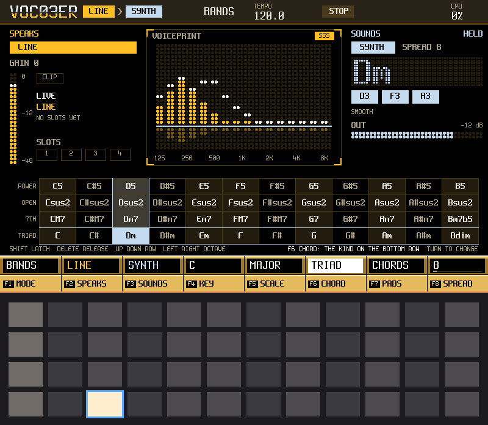

*PERFORM while a chord is held. SPEAKS is at the left, the voiceprint in the middle, SOUNDS at the right, the pads' chord grid under them.*

What you can do with it:

- **A vocoder.** Sing or speak, hold a chord on the pads, and the chord speaks your words.
- **A talkbox.** The same, taken as a smooth shape of the mouth, closer to a voice coming out of a tube.
- **Pitch correction.** Your voice, pulled to the notes of a key and scale you pick.
- **A robot voice.** The vocoder with a fast leveller after it, for a flat, hard, mechanical voice.
- **Recordings that speak.** Record a take, cut it into slices, and play the slices from the pads through the chord you hold.
- **A pattern and a song.** Sixteen steps of chords, up to eight patterns, chained into a song.
- **MIDI in.** Play the synth and the slices from a keyboard or a sequencer.

## 2. Install it, and go back to the stock firmware

O3-VOC03ER comes as one file, the image the Tracker's bootloader takes from the SD card: `o3-voc03er-<version>.ptf`. The project's
release notes say what a unit has shown of that version and what it has not.

O3-VOC03ER writes in two places on the card: its own folder `Apps/o3_voc03er/` (your projects and, when you ask, a few small settings
files) and the card's `Samples/` folder (the WAV files you save from SAMPLE EDIT). Your Tracker projects stay as they are.

### Install by the card

1. **Back up the whole card** on a computer.
2. **Keep your way back**: the image the unit runs now (the official `PolyendTracker_<version>.ptf`, or another firmware you use) stays
   safe on your computer.
3. On the card, move every `.ptf` file out of the `Firmware/` folder (for example into a new folder `Firmware-old/`).
4. Copy the image into `Firmware/` and rename the copy `PolyendTracker_0.0.1.ptf`. It must be the only `.ptf` in `Firmware/`: the reset
   button flashes the first `.ptf` in the card's directory order, which need not be the alphabetical order a computer shows, so with two
   files you cannot tell which one it takes.
5. Put the card back and press the Tracker's hidden reset button (the maker's emergency-flashing instructions say where it is). The
   bootloader writes the image and the unit starts O3-VOC03ER.

### Go back to the stock firmware

1. Move every `.ptf` out of `Firmware/`.
2. Put the official `PolyendTracker_<version>.ptf` alone in `Firmware/`.
3. Press the hidden reset button.

The bootloader is separate from the firmware, and an image that does not start does not remove it: the card and the reset button are the
way back. Keep the card backup and the old image at hand.

## 3. The first five minutes

You need a sound source. A line cable from a synth, a phone or a mixer is the easiest. A microphone works too. Nothing else is needed.

**1. Plug in and switch on.** The screen that comes up is PERFORM, the home screen. At the top you see the route: `LINE > SYNTH`. The first
time, the live source is LINE with its gain at 0, so a quiet source is not boosted by surprise.

**2. Check that the voice arrives.** Play something into the jack, or press MASTER and pick MIC on F1 and speak. The IN meter at the left
moves and the voiceprint in the middle flickers. Nothing sounds yet: the synth has no note.

**3. Press one pad on the bottom row.** A chord speaks your words. The screen names the chord and lights its notes. The next pad to the
right is another chord. Hold the pad while you sing. The wide pad row at the bottom is one chord per key: C major, D minor, and so on,
all in the key and scale that F4 and F5 say.

**4. Free your hands.** Hold SHIFT and press a chord pad: the chord is latched and keeps sounding after you let go. A new latch replaces
the old one. DELETE lets it go.

**5. Try the other voices.** Press F1 (MODE) to step from BANDS to TALK, TUNE and ROBOT. Section 5 says what each does.

**6. Record yourself.** Press REC on PERFORM and sing. The take is two bars long and ends by itself at the bar line. It plays back
looped, through the chord you hold. (SAMPLE REC does the same with every setting in sight, section 6.)

If the IN meter shows CLIP, lower the gain on MASTER. If it barely moves, raise it.

## 4. The screens, one by one

Every screen button on the Tracker opens its screen from anywhere. PERFORMANCE always takes you home. The row of eight keys under the
display is F1 to F8; what they do is written above them on the screen and changes with the screen. A second tap on a focused F key steps
its value; turning the encoder changes it too. SHIFT held shows a second row of values on PERFORM (below).

HELP is SHIFT + CONFIG: it lists every button and every F key of the screen you came from.

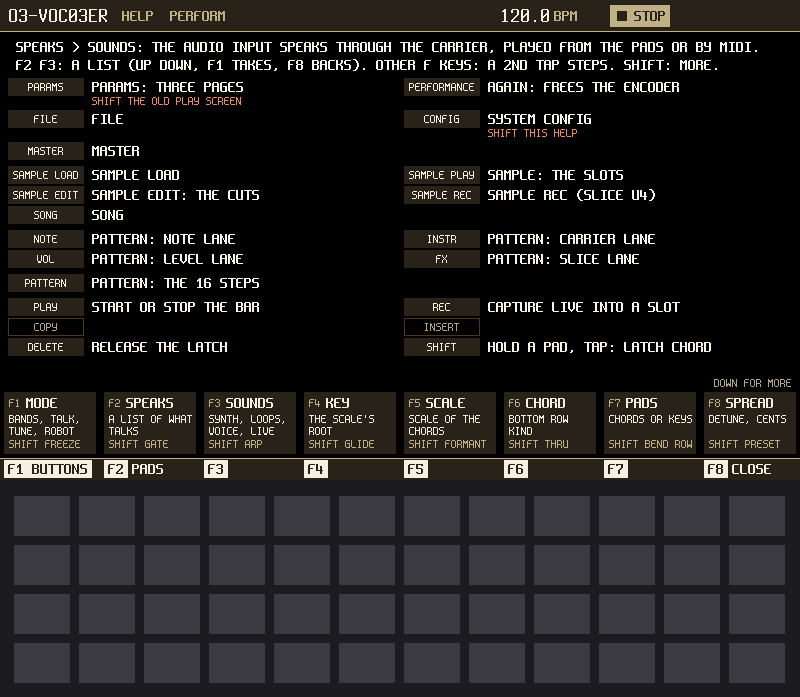

*HELP, opened from PERFORM. F1 BUTTONS and F2 PADS switch between its two pages; F8 closes it.*

### PERFORM

The home screen. SPEAKS on the left (the source, its gain meter and a CLIP lamp), the voiceprint in the middle with the mode over it, SOUNDS
on the right (the synth, the chord you play in big letters and its notes, the output meter). Under that, a drawing of the pads as they are
now.

| Key | What it does |
|---|---|
| F1 MODE | BANDS, TALK, TUNE or ROBOT (section 5). It steps one way: to go back, tap F1 to focus it and turn the encoder down |
| F2 SPEAKS | A list: LINE, LEFT, RIGHT, MIC LOW, MIC HIGH, RADIO, USB, or SLOT 1 to 4. UP and DOWN move, F1 takes the row, F8 backs out |
| F3 SOUNDS | A list: SYNTH, NOISE, LIVE, or SLOT 1 to 4 |
| F4 KEY | The root of the key. Chords and pitch correction share it |
| F5 SCALE | The scale: the chords and TUNE stay in it |
| F6 CHORD | What the bottom pad row plays: TRIAD, 7TH, OPEN or POWER |
| F7 PADS | CHORDS or KEYS (below) |
| F8 | By mode: BANDS SPREAD, TALK QUALITY, TUNE SPEED |
| SHIFT + F1 | FREEZE the vowel |
| SHIFT + F2 | GATE: chops the sound in time (OFF, 1/4, 1/8, 1/16, 1/32) |
| SHIFT + F3 | ARP: plays held notes one at a time (OFF, UP, DOWN, UP-DOWN, RANDOM) |
| SHIFT + F4 | GLIDE: slides between notes |
| SHIFT + F5 | FORMANT: moves the voice's colour up or down, as if the singer were smaller or bigger |
| SHIFT + F6 | THRU: lets some of the voice's top through |
| SHIFT + F7 | BEND ROW: the bottom pad row becomes a pitch-bend strip |
| SHIFT + F8 | PRESET: eight factory sounds |

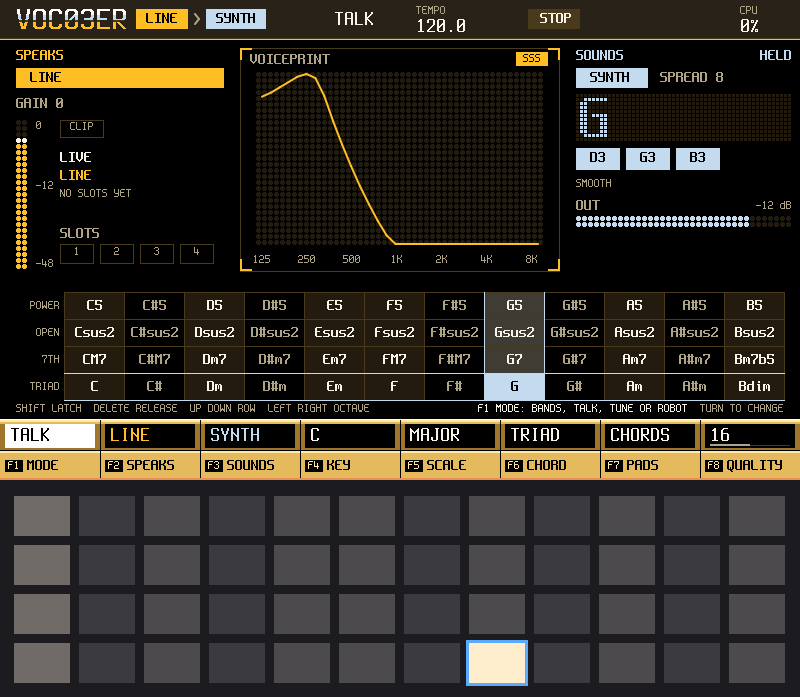

*PERFORM in TALK: the voiceprint is now a smooth curve, the shape of the mouth.*

**The pads in CHORDS.** The twelve columns are the twelve roots, C at the left. The bottom row plays the chord kind F6 names, the row above
it the seventh chord, then an open airy chord, then at the top the power chord (root, fifth, octave), the classic robot fifth. LEFT and
RIGHT move the octave.

**The pads in KEYS.** A piano: white keys on the third row, black keys above them. The top row has controls: OCT- and OCT+, VOL- and VOL+,
ROOT- and ROOT+, MOD (adds a little vibrato while held) and BND- and BND+ (bend while held). The row under the white keys is a formant
strip when BEND ROW is off.

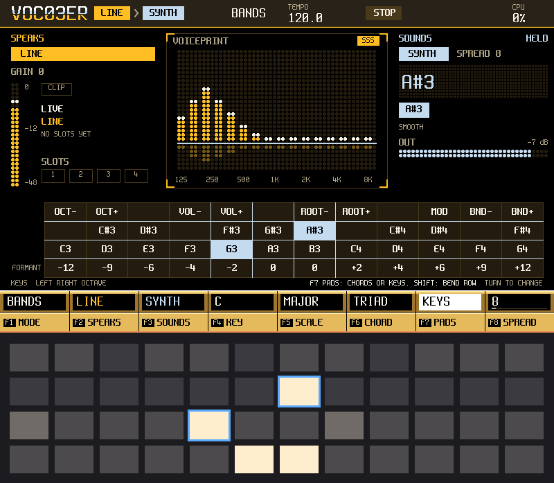

*PADS set to KEYS. The grid above the F keys draws the controls; the pad lights show the held keys.*

**Pitch bend.** The encoder bends the synth once it is free: press PERFORMANCE while on PERFORM to free it, and tap any F key to take it
back. It springs back to the middle about a tenth of a second after you stop turning. SHIFT makes the steps larger. BEND ROW (SHIFT + F7)
puts a strip of pads on the bottom row: the middle pair is zero, each pad outwards is a semitone. A bend moves the synth only: a live
source and a slot have no pitch of their own to move.

### PARAMS

PARAMS shows three pages of eight values on the F keys, with the voiceprint small above so you see each change. Press PARAMS again, or
UP and DOWN, to change page.

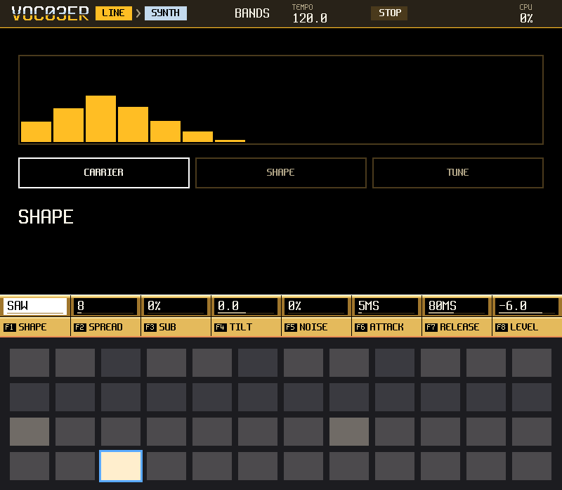

*CARRIER: SHAPE (the wave), SPREAD (how many detuned copies stack), SUB, TILT (dark to bright), NOISE (for the consonants), ATTACK, RELEASE and LEVEL.*

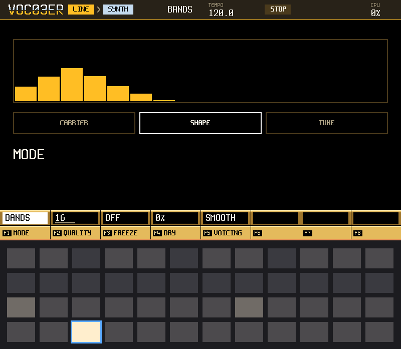

*SHAPE: MODE, QUALITY (how many bands), FREEZE, DRY (the voice mixed in as it is), and VOICING: how a chord's notes are laid out.*

VOICING has four settings. CLOSE stacks the notes as written. OPEN lifts the third an octave. WIDE spreads the chord over two octaves.
SMOOTH, the default, picks the arrangement nearest the chord before, so a progression moves without jumps.

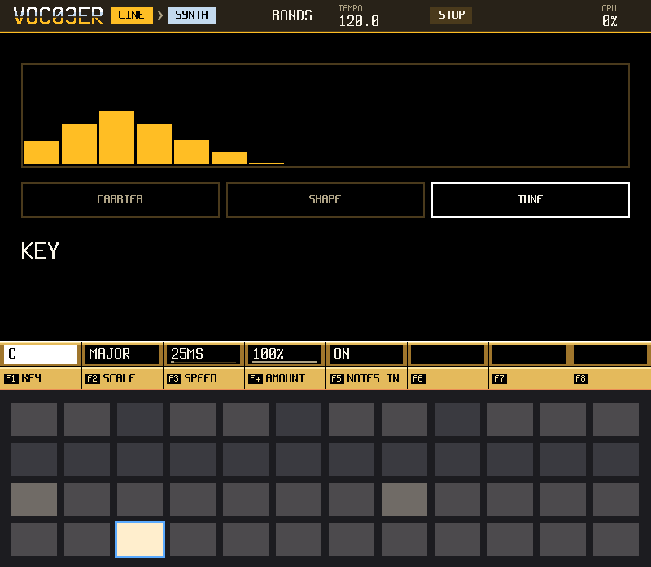

*TUNE: KEY, SCALE, SPEED (how fast a note is pulled), AMOUNT, and NOTES IN (follow the notes you play).*

### MASTER

MASTER draws the whole path large: LIVE on the left, the mode in the middle, OUTPUT on the right. Only one live source runs at a time: the
microphone, the line and the radio share one converter; USB audio is stereo.

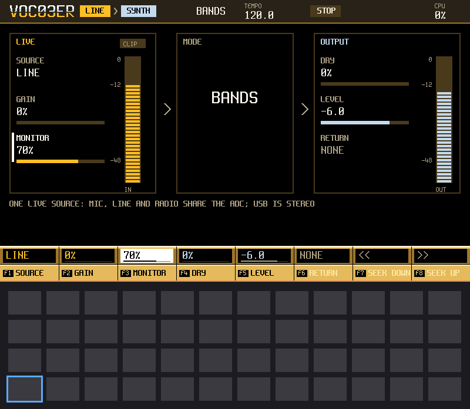

*MASTER with the monitor on, so you hear the live input directly while you set it.*

| Key | What it does |
|---|---|
| F1 SOURCE | LINE, LEFT, RIGHT, MIC LOW, MIC HIGH, RADIO or USB |
| F2 GAIN | The input gain. The meter shows what arrives |
| F3 MONITOR | Plays the live input straight to the output while you set levels |
| F4 DRY | How much of the original voice is mixed in |
| F5 LEVEL | The output level |
| F6 RETURN | The level of the sound sent back over USB |
| F7 SEEK DOWN, F8 SEEK UP | Radio only: look for the next station |

### SAMPLE, SAMPLE REC, SAMPLE EDIT, SAMPLE LOAD

These four screens are the sampler. Section 6 explains them with their pictures.

### PATTERN and SONG

Section 7.

### FILE

Section 9.

## 5. The four modes

The mode is the way the voiceprint is taken and applied. F1 on PERFORM steps through them.

**BANDS.** The classic vocoder. The voice is split into bands, each band's loudness is read, and the same bands of the synth are raised and
lowered to follow. It is clear and robotic, and it works on any voice or any sound. QUALITY sets how many bands. A note at the top of the
range has fewer bright harmonics to shape, so SPREAD, TILT and NOISE help the consonants.

**TALK.** The voice is described as a smooth curve of the mouth's resonances, and the synth is played through that curve. It sounds more
like a voice and less like a filter bank, the nearest thing here to a talkbox. It likes steady, voiced sounds. QUALITY sets how fine the
curve is. FREEZE holds a vowel while you play.

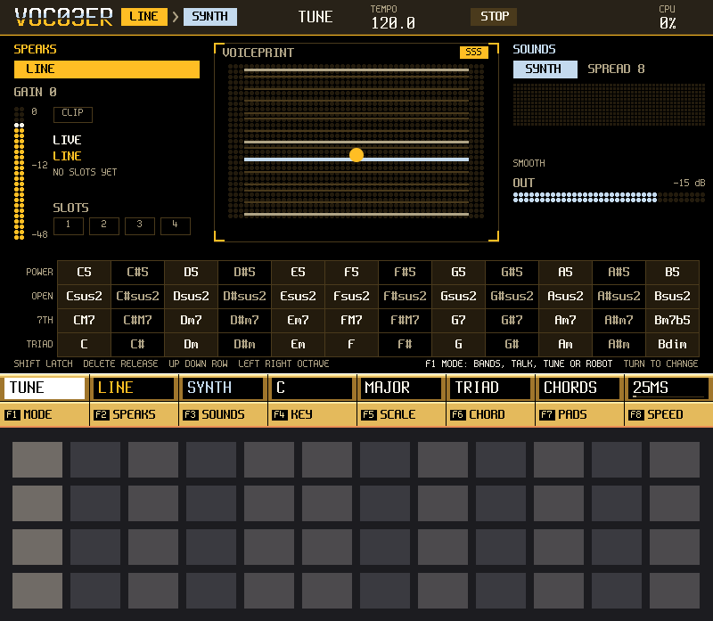

*TUNE: the voiceprint is a pitch ladder showing the note sung and the note it is pulled to.*

**TUNE.** Pitch correction. It follows the pitch of what SPEAKS and pulls it to the nearest note of the key and scale you set on F4 and F5.
It plays no synth. SPEED is how fast it pulls: at the fastest it steps from note to note, at the slowest it only leans. With NOTES IN on
(on the TUNE page of PARAMS), it pulls to the notes you hold on the pads or play by MIDI.

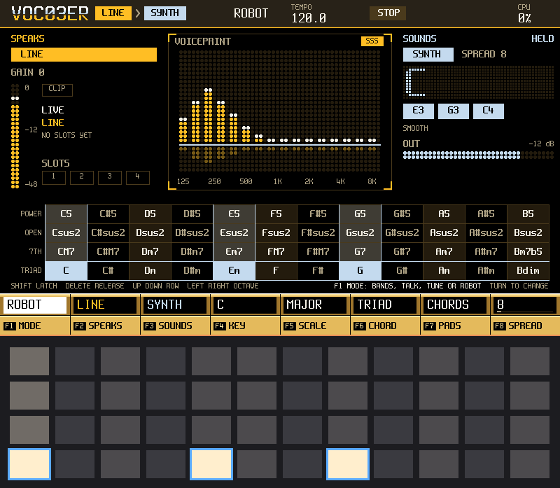

*ROBOT: BANDS with a fast leveller after it. The voice is flattened and hard.*

**ROBOT.** BANDS with a fast leveller after it. Loud and soft syllables come out at about the same level, which gives the flat, mechanical
voice. Hold a fifth, or the top pad row, for the classic robot sound.

## 6. Samples and slices

A **slot** holds up to 16 seconds of mono sound. There are four. A slot is recorded (SAMPLE REC, or REC on PERFORM) or loaded from a WAV
file (SAMPLE LOAD), cut into up to 24 **slices** (SAMPLE EDIT) and played from the pads (SAMPLE). A slot can be on a side: it can speak,
or it can sound, so a recording can be the voice or the instrument.

### SAMPLE REC

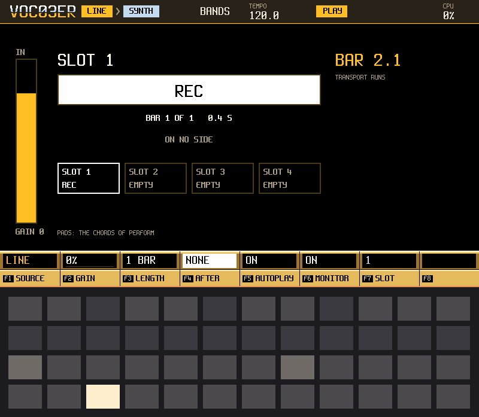

*A take in progress. The slot's name and state are in big type; the bar counter is at the right.*

SAMPLE REC makes a take with every setting visible. REC starts it at the next bar line (at once if the transport is stopped); REC again ends
it at the bar. LENGTH can end it by itself.

| Key | What it does |
|---|---|
| F1 SOURCE | LINE, LEFT, RIGHT, MIC LOW, MIC HIGH, RADIO or USB |
| F2 GAIN | The input gain |
| F3 LENGTH | FREE, or 1, 2, 4 or 8 bars |
| F4 AFTER | Which side the finished take goes to: SPEAKS, SOUNDS or NONE |
| F5 AUTOPLAY | ON: the take plays at once, looped |
| F6 MONITOR | Hear the live input while you record |
| F7 SLOT | Which slot, 1 to 4 (UP and DOWN too) |

DELETE throws a take away.

### SAMPLE

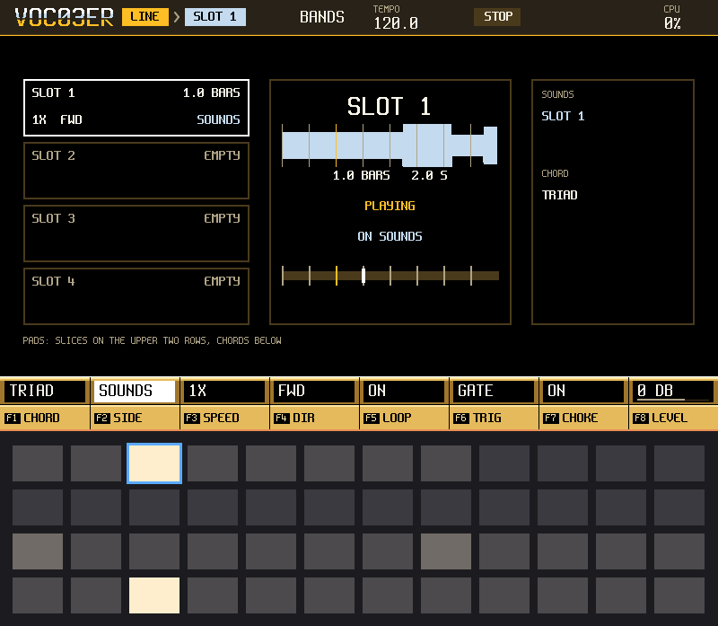

*SAMPLE: the top two pad rows are slices 1 to 24 of the slot. The bottom rows are the chords. One slice is sounding.*

The top two pad rows are the slices of the selected slot. The bottom two rows are chords. **Hold a slice and a chord together, and the
slice sings that chord.** SHIFT + a chord pad latches it so one hand can play slices over it. Four slices can sound at once.

| Key | What it does |
|---|---|
| F1 CHORD | The chord kind, shared with PERFORM |
| F2 SIDE | Which side the slot is on: SPEAKS, SOUNDS or NONE |
| F3 SPEED | 0.5X, 1X or 2X |
| F4 DIR | FWD or REV |
| F5 LOOP | The whole slot plays round from the bar |
| F6 TRIG | GATE: a slice stops when you let go. ONE SHOT: it plays to its end |
| F7 CHOKE | ON: a new slice cuts the one sounding. OFF: they overlap |
| F8 LEVEL | -24 to +12 dB |

UP and DOWN pick the slot. DELETE silences every sounding slice.

### SAMPLE EDIT

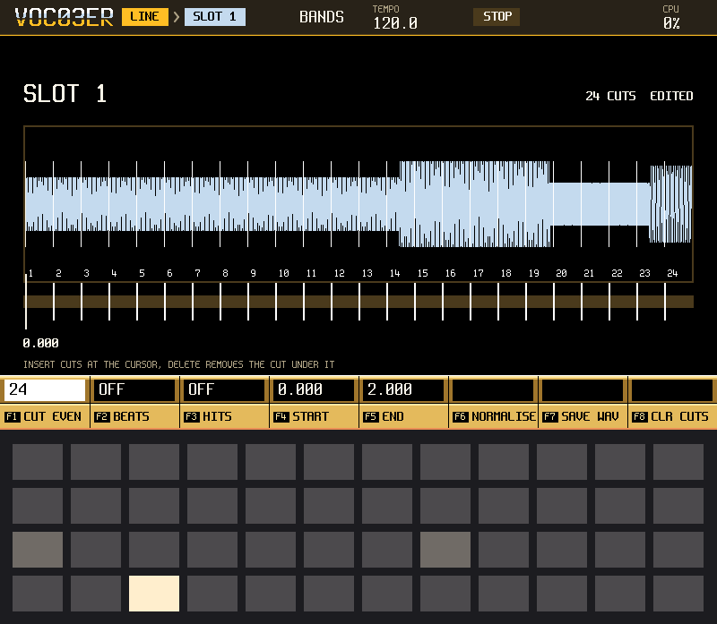

*SAMPLE EDIT: the take across the screen, cuts as numbered marks, trim as brackets.*

SAMPLE EDIT shows the take across the whole screen. Cuts are marks numbered 1 to 24. The encoder moves the cursor; LEFT and RIGHT jump
from cut to cut. INSERT makes a cut at the cursor, DELETE removes one. A pad of the top rows plays that slice with the chord of the bottom
rows.

| Key | What it does |
|---|---|
| F1 CUT EVEN | Cuts into 8, 16 or 24 equal parts |
| F2 CUT BEATS | Cuts on the beats the take was recorded on (a recording only) |
| F3 CUT HITS | Cuts at the loud starts of sounds. Higher is more sensitive |
| F4 START, F5 END | Trim the take |
| F6 NORMALISE | Raises the level to the top. F1 confirms |
| F7 SAVE WAV | Saves the slot as a WAV file in the card's `Samples/` folder |
| F8 CLR CUTS | Removes every cut |

F1 to F3 replace the cuts you have; the screen says how many it replaces before you commit. A cut lands on a quiet crossing point close by
so it does not click. COPY copies the slot, cuts and all, to the next empty slot.

### SAMPLE LOAD

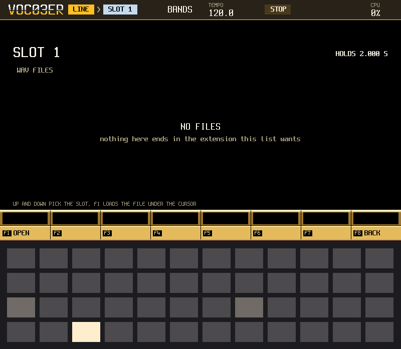

*SAMPLE LOAD with an empty card: it says so. Put WAV files in the app's folder and they are listed here.*

SAMPLE LOAD lists the WAV files in `Apps/o3_voc03er/` on the card. To put files there, use Config's CARD AS DISK to see the card from a
computer, or put the card in a computer. UP and DOWN pick a file, F1 loads it into the selected slot, F8 goes back. Files must be 16-bit,
44.1 kHz, mono or stereo (stereo is mixed to mono). A longer file gives its first 16 seconds, and the strip says so. A slot that already
holds a sample asks first: F1 confirms, any other key cancels.

## 7. Patterns and songs

### PATTERN

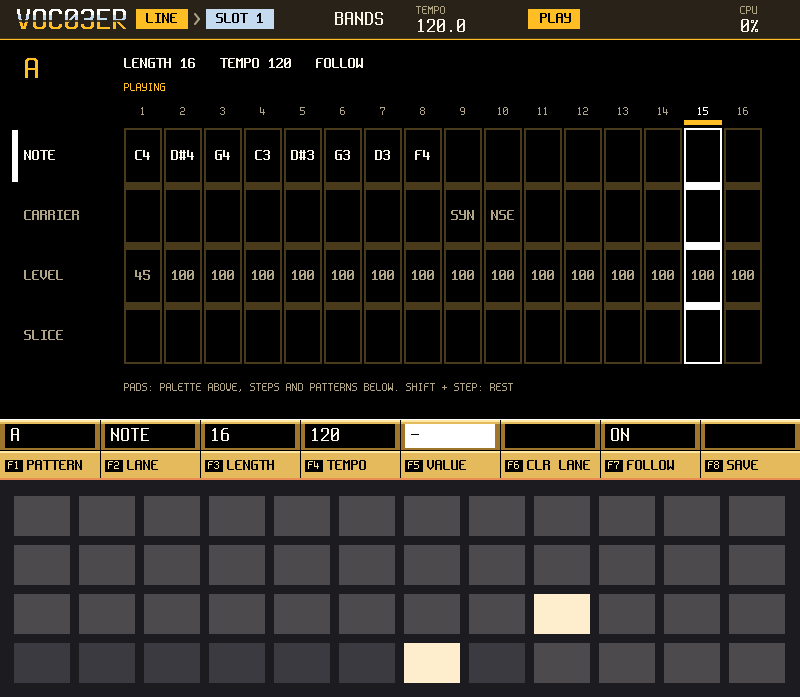

*PATTERN playing with FOLLOW on: the bright frame is the playhead.*

Eight patterns, A to H, of up to sixteen steps each. Each step has four lanes: **NOTE** (a chord or a note), **CARRIER** (what sounds on that
step: FOLLOW, SYNTH, NOISE or a slot), **LEVEL** and **SLICE** (which slice of the speaking slot fires). NOTE, INSTR (carrier), VOL (level)
and FX (slice) pick the lane; so do F2 and UP and DOWN.

The pads: the top two rows are the lane's palette (the chord grid for NOTE, the carriers for CARRIER, steps of level, slices). A palette
pad writes into the step under the cursor and moves the cursor on. The lower two rows, columns 1 to 8, are the sixteen steps. The lower
right columns pick the pattern, A to H. SHIFT + a step pad makes it a rest.

| Key | What it does |
|---|---|
| F1 PATTERN | A to H |
| F2 LANE | NOTE, CARRIER, LEVEL or SLICE |
| F3 LENGTH | 1 to 16 steps |
| F4 TEMPO | The tempo |
| F5 VALUE | The cursor step's value in the lane; the encoder edits it |
| F6 CLR LANE | Clears the lane. F1 confirms |
| F7 FOLLOW | The cursor rides the playhead |
| F8 SAVE | Saves the project |

PLAY starts and stops the transport. COPY copies the step under the cursor (SHIFT: the whole pattern); INSERT pastes it. DELETE clears
the step (SHIFT: the whole pattern). A different pattern starts when the one that plays ends.

### SONG

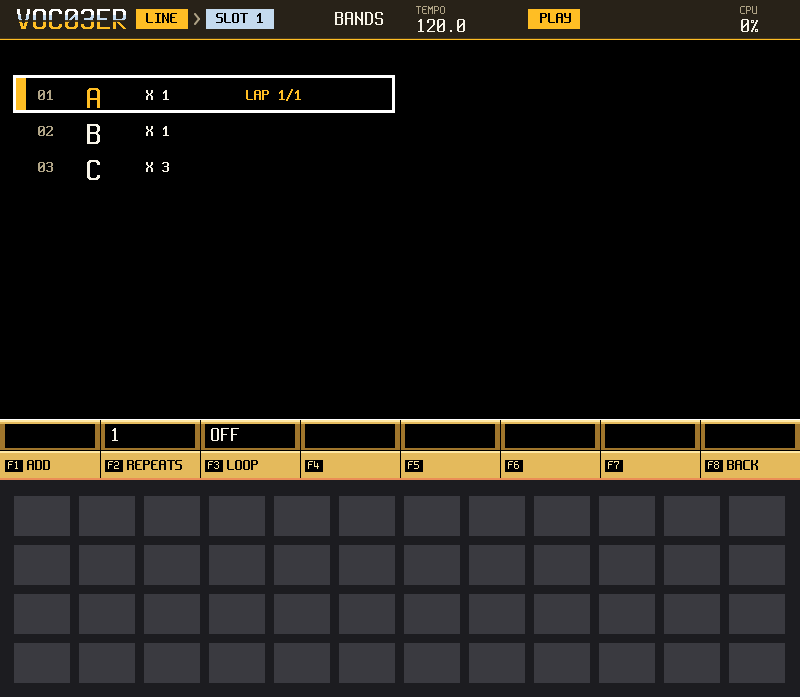

*SONG playing: the bar at the left of a row says it is the lap in progress.*

SONG chains patterns: up to sixteen rows, each a pattern letter and a number of repeats. UP and DOWN move the cursor; the encoder changes the
row's letter, and after F2 its repeats (1 to 64). F1 ADD or INSERT adds a row after the cursor, DELETE removes one. PLAY with SONG open
starts from the cursor's row. At the end of the chain the transport stops, unless F3 LOOP is on, which runs the chain round.
## 8. MIDI

MIDI notes play the synth beside the pads and share its voices. They also feed TUNE when NOTES IN is on. Pitch bend moves the synth; the
mod wheel (CC 1) adds vibrato. A controller can be learned onto any value, sixteen at most.

Slices: notes from 36 up fire one slice each of the SPEAKS slot (36 is slice 1). Velocity 100 and above is full level; lower is softer.
The slice plays to its end; letting go of the key does not stop it. Every other note plays the synth.

Patterns: a program change from 0 to 7 picks pattern A to H, at the end of the pattern that plays. A higher number is ignored. While
a SONG chain plays, it owns the pattern, so a program change then does nothing. Notes you play are written into PATTERN's lanes the way
the pads write them.

Clock: set FOLLOW in Config, and FOLLOW PORT to the port the clock comes from. USB clock has been tried with a host; the DIN port has not.

## 9. Projects and the card

A project is a folder under `Apps/o3_voc03er/` that holds one project file. It keeps the eight patterns, the song chain, the route, and
each slot's cuts, trim, speed, direction, level and the name of the WAV it came from. It does not keep the tempo, the octave, the pad
mode or the WAV sound itself: F5 SAVE WAVS writes the sounds into the project folder.

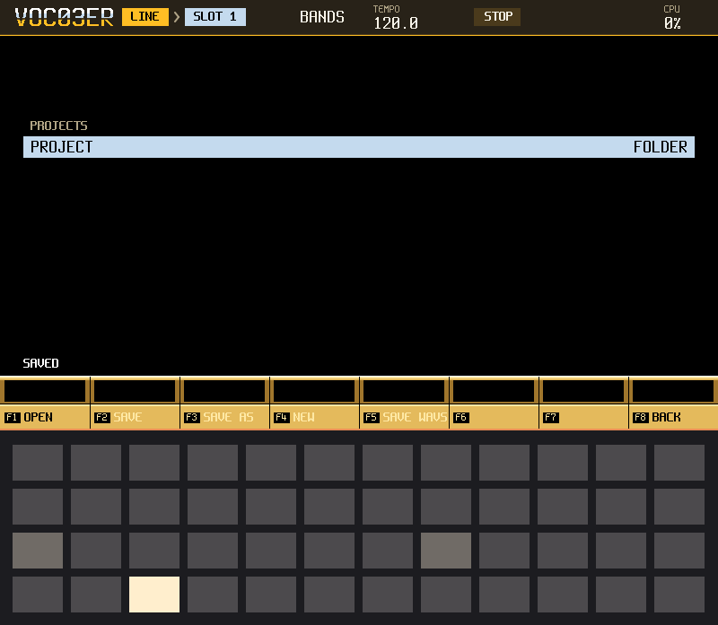

*FILE after a save: one project, and the strip says SAVED.*

| Key | What it does |
|---|---|
| F1 OPEN | Opens the project under the cursor, then its WAV files one by one; a slot is grey until its sound has landed |
| F2 SAVE | Saves the current project. The first time it asks for a name |
| F3 SAVE AS | Saves under a new name |
| F4 NEW | Starts an empty project |
| F5 SAVE WAVS | Writes each slot's sound next to the project file. A slot can take a while on a slow card |
| F8 BACK | Leaves FILE |

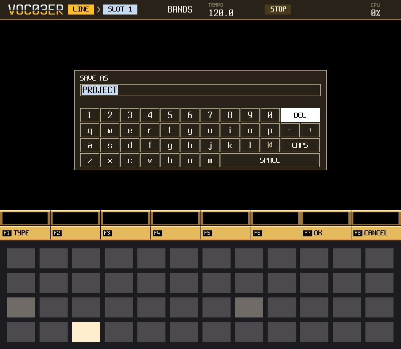

*SAVE AS: the name is typed with the on-screen keys. F1 changes the type, F7 accepts, F8 cancels.*

Nothing is saved by itself: FILE saves only when you tell it. Not kept in a project: the octave, the tempo, the current pattern, the chord
kind and the pad mode. The app also keeps two small files of its own in `Apps/o3_voc03er/`, `pattern.o3a` (the working patterns) and
`config.o3a` (settings); the previous copy of the patterns is kept beside it as `pattern.o3a.bak`. A damaged project file is refused
whole.

## 10. Known limits, and what needs more testing

This is a first public pre-release. The firmware has been measured on a unit for the load it puts on the processor, and the screens have
been read there, but several things need more testing, most of all by ear. In particular:

- **The sound.** How the four modes sound with a real voice, how the synth sounds at the top of its range, the level of TALK, and the
  eight presets are for your ears. Nothing here says a sound is right.
- **The microphone and the radio.** Switching between them has been seen; how they sound needs a person.
- **Clicks** at the switch when a take is captured from a live source need more testing.
- **Glide, gate, arp, vibrato and the bend** need more testing by hand and ear, and so do the formant steps and the VOL, ROOT and BND
  pads on KEYS.
- **MIDI.** USB MIDI has been seen working. A DIN cable has not been run: no interface was at hand.
- **SONG.** The exact step where a change lands, the stop at the end of a chain and a pattern of length 1 at a boundary need more testing
  on the unit.
- **Heavy use.** With every mode, a long chain and a full set of slots on screen at once, the processor load has not been measured in all
  its combinations.
- **A WAV that is not 16-bit 44.1 kHz** is refused. A file longer than 16 seconds is cut to its first 16.
- **Bending a slot** is not possible: a recording plays at three fixed speeds.
- **The voiceprint in the pictures** comes from plain tones. A voice draws more bars.

If something here fails on your unit, the card and the reset button are the way back (section 2).

*This manual follows the firmware as it is in this repository. The pictures are made by `app/scenarios/manual_screens.txt`.*
