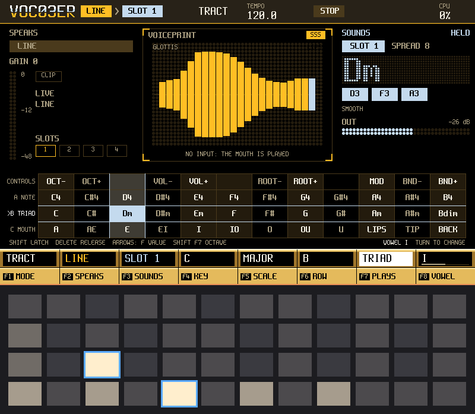

# O3-VOC03ER player's manual

O3-VOC03ER turns the Tracker into a voice machine. Your voice, or a recording, shapes a synth you play with the 48 pads: a vocoder, a
talkbox, a pitch corrector, a robot voice and a played mouth in one instrument, with a sampler, a step sequencer and a song chain beside it. This manual
starts with what makes sound fastest and goes deeper as it goes on. You can stop reading after section 3 and play.

The pictures come from the O3-VOC03ER simulator, which draws the same screens as the unit. Where a picture also shows the pads, the grid
under the screen is the simulator's drawing of the pad lights. The simulator is fed plain tones for a voice, so the voiceprint in the
pictures is thinner than a real voice would make it.

> **Unofficial.** O3-VOC03ER is not affiliated with or endorsed by Polyend. "Tracker" is used only to describe the hardware it runs on.

## Contents

1. [What O3-VOC03ER is](#1-what-o3-voc03er-is)
2. [Install it, and go back to the stock firmware](#2-install-it-and-go-back-to-the-stock-firmware)
3. [The first five minutes](#3-the-first-five-minutes)
4. [The screens, one by one](#4-the-screens-one-by-one)
5. [The five modes](#5-the-five-modes)
   - [5b. TRACT: a mouth after the carrier](#5b-tract-a-mouth-after-the-carrier)
6. [Samples and slices](#6-samples-and-slices)
7. [Patterns and songs](#7-patterns-and-songs)
8. [MIDI](#8-midi)
9. [Projects and the card](#9-projects-and-the-card)
10. [Known limits, and what needs more testing](#10-known-limits-and-what-needs-more-testing)

## 1. What O3-VOC03ER is

O3-VOC03ER is a whole firmware for the Tracker hardware. It replaces the Tracker's own software while it is installed (section 2 says how
to go back). It is one instrument built on one idea: **something speaks, something sounds.**

- **SPEAKS** is the voice: a microphone, a line input, the radio, USB audio, or a recording in one of four slots.
- **SOUNDS** is what that voice plays through: a synth, noise, the live input, or a recording.
- In the middle is the **voiceprint**: sixteen bars that show, live, the shape of the voice that is speaking.

*PERFORM while a chord is held. SPEAKS is at the left, the voiceprint in the middle, SOUNDS at the right, a drawing of the pads under them.*

What you can do with it:

- **A vocoder.** Sing or speak, hold a chord on the pads, and the chord speaks your words.
- **A talkbox.** The same, taken as a smooth shape of the mouth, closer to a voice coming out of a tube.
- **Pitch correction.** Your voice, pulled to the notes of a key and scale you pick.
- **A robot voice.** The vocoder with a fast leveller after it, for a flat, hard, mechanical voice.
- **A played mouth.** TRACT: nothing is analysed. The sound you play goes through a model of a mouth that you shape with the pads, the
  encoder or a pattern, to make it say vowels and simple sung words.
- **Recordings that speak.** Record a take, cut it into slices, and play the slices from the pads through the chord you hold.
- **A pattern and a song.** Sixteen steps of chords, up to eight patterns, chained into a song.
- **MIDI in.** Play the synth and the slices from a keyboard or a sequencer.

## 2. Install it, and go back to the stock firmware

O3-VOC03ER comes as one file, the image the Tracker's bootloader takes from the SD card: `o3-voc03er-<version>.ptf`. The project's
release notes say what a unit has shown of that version and what it has not.

O3-VOC03ER writes in two places on the card: its own folder `Apps/o3_voc03er/` (your projects and, when you ask, a few small settings
files) and the card's `Samples/` folder (the WAV files you save from SAMPLE EDIT). Your Tracker projects stay as they are.

### Install by the card

1. **Back up the whole card** on a computer.
2. **Keep your way back**: the image the unit runs now (the official `PolyendTracker_<version>.ptf`, or another firmware you use) stays
   safe on your computer.
3. On the card, move every `.ptf` file out of the `Firmware/` folder (for example into a new folder `Firmware-old/`).
4. Copy the image into `Firmware/` and rename the copy `PolyendTracker_0.0.1.ptf`. It must be the only `.ptf` in `Firmware/`: the reset
   button flashes the first `.ptf` in the card's directory order, which need not be the alphabetical order a computer shows, so with two
   files you cannot tell which one it takes.
5. Put the card back and press the Tracker's hidden reset button (the maker's emergency-flashing instructions say where it is). The
   bootloader writes the image and the unit starts O3-VOC03ER.

### Go back to the stock firmware

1. Move every `.ptf` out of `Firmware/`.
2. Put the official `PolyendTracker_<version>.ptf` alone in `Firmware/`.
3. Press the hidden reset button.

The bootloader is separate from the firmware, and an image that does not start does not remove it: the card and the reset button are the
way back. Keep the card backup and the old image at hand.

## 3. The first five minutes

You need a sound source. A line cable from a synth, a phone or a mixer is the easiest. A microphone works too. Nothing else is needed.

**1. Plug in and switch on.** The screen that comes up is PERFORM, the home screen. At the top you see the route: `LINE > SYNTH`. The first
time, the live source is LINE with its gain at 0, so a quiet source is not boosted by surprise.

**2. Check that the voice arrives.** Play something into the jack, or press MASTER and pick MIC on F1 and speak. The IN meter at the left
moves and the voiceprint in the middle flickers. Nothing sounds yet: the synth has no note.

**3. Press one pad of the middle row of the three.** A chord speaks your words. The screen names the chord and lights its notes. The next
pad to the right is another chord. Hold the pad while you sing. That row, B, is one chord per key: C major, D minor, and so on, all in the key
and scale that F4 and F5 say. The row above it, A, plays single notes, and the pads layout (section 4, PERFORM) says how to change both.

**4. Free your hands.** Hold a chord pad and press SHIFT: the chord is latched and keeps sounding after you let go. A new latch replaces
the old one. DELETE lets it go. (SHIFT first and then a pad latches nothing.)

**5. Try the other voices.** Press F1 (MODE) to step from BANDS to TALK, TUNE, ROBOT and TRACT. Section 5 says what each does.

**6. Record yourself.** Press REC on PERFORM and sing. The take is two bars long and ends by itself at the bar line. It plays back
looped, through the chord you hold. (SAMPLE REC does the same with every setting in sight, section 6.)

If the IN meter shows CLIP, lower the gain on MASTER. If it barely moves, raise it.

## 4. The screens, one by one

Every screen button on the Tracker opens its screen from anywhere. PERFORMANCE always takes you home. The row of eight keys under the
display is F1 to F8; what they do is written above them on the screen and changes with the screen. A second tap on a focused F key steps
its value; turning the encoder changes it too. SHIFT held shows a second row of values on PERFORM (below).

HELP is SHIFT + CONFIG: it lists every button and every F key of the screen you came from.

*HELP, opened from PERFORM. F1 BUTTONS and F2 PADS switch between its two pages; F8 closes it.*

### PERFORM

The home screen. SPEAKS on the left (the source, its gain meter and a CLIP lamp), the voiceprint in the middle with the mode over it, SOUNDS
on the right (the synth, the chord you play in big letters and its notes, the output meter). Under that, a drawing of the pads as they are
now.

| Key | What it does |
|---|---|
| F1 MODE | BANDS, TALK, TUNE, ROBOT or TRACT (section 5). A tap steps round, from TRACT back to BANDS; the encoder stops at the ends |
| F2 SPEAKS | A list: LINE, LEFT, RIGHT, MIC LOW, MIC HIGH, RADIO, USB, or SLOT 1 to 4. UP and DOWN move, F1 takes the row, F8 backs out |
| F3 SOUNDS | A list: SYNTH, NOISE, LIVE, or SLOT 1 to 4 |
| F4 KEY | The root of the key. Chords and pitch correction share it |
| F5 SCALE | The scale: the chords and TUNE stay in it |
| F6 ROW | Which pad row F7 sets: A, B or C. A tap steps and wraps; the encoder stops at the ends. The row's pads flash once |
| F7 PLAYS | What the chosen row plays: notes, chords or a parameter strip (below). Hold a pad of A, B or C and F7 changes that pad's row at once |
| F8 | By mode: BANDS SPREAD, TALK QUALITY, TUNE SPEED, TRACT VOWEL |
| SHIFT + F1 | FREEZE the vowel |
| SHIFT + F2 | GATE: chops the sound in time (OFF, 1/4, 1/8, 1/16, 1/32) |
| SHIFT + F3 | ARP: plays held notes one at a time (OFF, UP, DOWN, UP-DOWN, RANDOM) |
| SHIFT + F4 | GLIDE: slides between notes |
| SHIFT + F5 | FORMANT: moves the voice's colour up or down, as if the singer were smaller or bigger |
| SHIFT + F6 | THRU: lets some of the voice's top through |
| SHIFT + F7 | OCTAVE: the octave of the pads, -3 to +2 (the same value the OCT- and OCT+ pads step) |
| SHIFT + F8 | PRESET: eight factory sounds |

*PERFORM in TALK: the voiceprint is now a smooth curve, the shape of the mouth.*

**The pads layout.** This is the one place that explains the pads; PATTERN, SAMPLE, SAMPLE REC, SAMPLE EDIT and PARAMS play the same layout and
point here. The top pad row is always the controls: OCT- and OCT+, VOL- and VOL+, ROOT- and ROOT+, MOD (adds a little vibrato while held) and
BND- and BND+ (bend while held). Below it are three rows, A, B and C from the top, and the twelve columns are the twelve roots, C at the left, in
the key and scale of F4 and F5. Each row has a PLAYS value. F6 ROW chooses the row (the row's pads flash once) and F7 PLAYS chooses what it
plays, in this order:

- **Rows A and B:** NOTE, TRIAD, 7TH, OPEN, POWER, OFF, then the parameter strips of the current mode (below).
- **Row C:** NOTE, TRIAD, 7TH, OPEN, POWER, FORMANT, BEND, MOUTH, OFF, then the parameter strips.

A tap on F7 steps on and wraps round; the encoder stops at the ends, and SHIFT with the encoder jumps from one group of the list to the next
(NOTES, CARRIER, SHAPE, TUNE, TRACT, PLAY; the screen names the group). The row's name sits beside it on the screen: a note value shows its
kind, a strip shows the parameter's name.

- NOTE: one note per pad. TRIAD, 7TH (the seventh chord), OPEN (root, fifth, ninth: open and airy) and POWER (root, fifth, octave: the
  classic robot fifth): a chord per pad, the one the scale gives on that root.
- **A parameter strip** (any row): the twelve pads of the row are one parameter of the current mode, the same value PARAMS shows. A press sets
  the value and it stays when you let go; PARAMS shows it and the project saves it, as a turn of the encoder would. Pad 1 is the lowest value
  and pad 12 the highest; a value that crosses zero (TILT, TONGUE, JAW, LIPS) has the middle pair both at 0. A parameter with twelve choices or
  fewer gets one pad per choice (the rest dark); one with more spreads the twelve pads over the choices. The nearest pad to the current value is
  the brighter one. A strip row plays no notes, like MOUTH, so the rows above keep the octave to themselves.
  - BANDS, TALK and ROBOT offer SHAPE, SPREAD, SUB, TILT, NOISE, ATTACK, RELEASE, DRY, VOICING, KEY, SCALE, THRU, GLIDE, GATE and ARP; TALK also
    FREEZE. TUNE offers DRY, VOICING, KEY, SCALE, SPEED, AMOUNT, NOTES IN, GLIDE, GATE and ARP.
  - TRACT offers DRY, VOICING, KEY, SCALE, GLIDE, GATE, ARP, the mouth's VOWEL, TONGUE, JAW, LIPS, T GLIDE, SIZE, RES, HISS, ACCENT and SOURCE,
    and the three closures CL LIPS, CL TIP and CL BACK (the whole row is that closure: held while a pad is down, open again on let-go, the
    last pad pressed wins), besides the MOUTH value.
  - Left out, because a wrong pad would do harm or another control owns it: MODE, QUALITY (a cost and a reallocation), LEVEL (the VOL pads), VIB (the
    MOD pad), BEND and FORMANT (their own values), the carrier and modulator sources and the live channel (SOUNDS, SPEAKS and SAMPLE), TRACT's CLOSE
    as a number (the closure strips), SLIDE and MIX (written by the word line and the mode change).
- FORMANT and BEND (row C only): FORMANT is a strip of semitones: a tap sets the formant and nothing is held. BEND is the pitch-bend strip:
  the middle pair is zero, each pad outwards is a semitone, and it springs back when you let go.
- MOUTH (row C only): the mouth strip of TRACT (section 5b). In the other modes the row is dark and the screen says MOUTH SPEAKS IN TRACT.
- OFF: the row is dark and silent.

**Each mode keeps its own three rows.** Switching mode with F1 shows that mode's layout and keeps the edits of every other. The default is A NOTE,
B TRIAD and C FORMANT in BANDS, TALK, TUNE and ROBOT, and A VOWEL, B TONGUE and C CL TIP in TRACT. A strip of a parameter another mode uses is
dark and the screen says where it lives (for example "... IN TRACT").

**Each row that plays notes sits one octave above the playing rows under it**, so a note on row B is one octave over the same pad on row C. The
OCT- and OCT+ pads and SHIFT + F7 move the octave of all of them. VOICING SMOOTH keeps to the pad's own octave: a progression along a row still
moves smoothly, and a row higher sounds higher.

**The arrow keys.** LEFT and RIGHT step the value of the F key that has the focus, one click of the encoder each; UP and DOWN do the same (RIGHT and
UP raise, LEFT and DOWN lower). On PATTERN the arrows keep their own jobs (LEFT and RIGHT the cursor, UP and DOWN the octave); on SAMPLE LEFT and
RIGHT step the F value and UP and DOWN pick the slot. The arrows leave three values to a tap of their key or the encoder, since a stray press there
changes the sound's character: F1 MODE, F8 QUALITY on TALK and SHIFT + F8 PRESET.

**The shortcut:** while you hold a pad of A, B or C, F7 changes that pad's row at once, and F6 follows it. SHIFT tapped while a pad is held
latches it, on any row that plays notes; DELETE lets it go. The screen names each row's value beside it. **The five layouts are saved with the
project** (section 9) and F4 NEW puts them back to the default. Recording a strip into a PATTERN lane is not built: a strip sets the value live.

**Pitch bend.** The encoder bends the synth once it is free: press PERFORMANCE while on PERFORM to free it, and tap any F key to take it
back. It springs back to the middle about a tenth of a second after you stop turning. SHIFT makes the steps larger. Set row C to BEND
(F6, then F7) for a strip of pads: the middle pair is zero, each pad outwards is a semitone. A bend moves the synth and every sounding slot (a
loop, a slice, a region): a slot plays faster or slower by the same number of semitones, up to an octave either way, so its pitch and its length
change together, as with a tape, and the glide of the bend is smooth. The live input has no pitch of its own to move, and the vibrato moves the synth
only. A loop that is on the bar drifts off it while it is bent; when the bend is back in the middle the loop is put back on the bar at the next bar line
(with the same short crossfade as any re-sync). A bend of zero plays a slot exactly as before, and a bend smaller than a fiftieth of a semitone counts as
zero for the slots. A bent slot is noisier in the highs: the read is a straight line between samples, which is cheap but lets some aliasing through (about
43 dB below the signal on a 2 kHz tone and 68 dB on a 441 Hz tone, measured on the host), so a bright loop bent up sounds rougher than a dull one.

### PARAMS

PARAMS shows four pages of eight values on the F keys, with the voiceprint small above so you see each change. Press PARAMS again, or
UP and DOWN, to change page.
The pads play PERFORM's layout here too.

**Learn a controller.** Hold SHIFT and press a value's F key: the key lights, the line under the big name says LEARN and the value's name, MOVE A KNOB,
and the next controller you move (CC 0 to 119, on DIN or USB) is bound to that value; the strip says LEARNED CC and its number. From then
on the knob moves the value, and a knob does nothing until it has reached the value, so the value never jumps. The same SHIFT + F key again cancels (LEARN OFF), and
so does leaving the page or the screen. While you hold SHIFT the F row reads LEARN on every value that can take a controller and "-" on VOICING, which is the
app's own setting and cannot, and on MODE and QUALITY, which are not live gestures (MODE swaps the layout, QUALITY reallocates TALK's LPC order). A value takes one controller and a controller moves one value; learning a value again replaces its controller. The
bindings are kept with the unit's settings, not with the project. Binding CC 1 takes the mod wheel away from the vibrato (a bound controller no longer reaches the app). This needs more testing on the unit with a real controller.

*CARRIER: SHAPE (the wave), SPREAD (how many detuned copies stack), SUB, TILT (dark to bright), NOISE (for the consonants), ATTACK, RELEASE and LEVEL.*

*SHAPE: MODE, QUALITY (TALK's detail; dim in the other modes, where it does nothing), FREEZE, DRY (the voice mixed in as it is), and
VOICING: how a chord's notes are laid out.*

VOICING has four settings. CLOSE stacks the notes as written. OPEN lifts the third an octave. WIDE spreads the chord over two octaves.
SMOOTH, the default, picks the arrangement nearest the chord before, within the pad's octave, so a progression moves without jumps.

The SHAPE page's sixth key is MOUTH (F6): PADS, the default, or LIVE. It only matters in TRACT, where it says what moves the mouth (section 5b, "Your voice as the mouth"); outside TRACT the key is dim and a tap does nothing. It is not kept with the project and starts as PADS each time.

*TUNE: KEY, SCALE, SPEED (how fast a note is pulled), AMOUNT, and NOTES IN (follow the notes you play).*

**TRACT**, the fourth page, is the mouth of TRACT mode (section 5b says what each value does): VOWEL, TONGUE, JAW, LIPS, GLIDE, SIZE, RES and
HISS. The values are live in every mode and speak in TRACT only; in the other modes the page says TRACT MODE ONLY and keeps them.

### MASTER

MASTER draws the whole path large: LIVE on the left, the mode in the middle, OUTPUT on the right. Only one live source runs at a time: the
microphone, the line and the radio share one converter; USB audio is stereo.

*MASTER with the monitor on, so you hear the live input directly while you set it.*

| Key | What it does |
|---|---|
| F1 SOURCE | LINE, LEFT, RIGHT, MIC LOW, MIC HIGH, RADIO or USB |
| F2 GAIN | The input gain. The meter shows what arrives |
| F3 MONITOR | Plays the live input straight to the output while you set levels |
| F4 DRY | How much of the original voice is mixed in |
| F5 LEVEL | The output level |
| F6 RETURN | The level of the sound sent back over USB |
| F7 SEEK DOWN, F8 SEEK UP | Radio only: look for the next station |

### SAMPLE, SAMPLE REC, SAMPLE EDIT, SAMPLE LOAD

These four screens are the sampler. Section 6 explains them with their pictures.

### PATTERN and SONG

Section 7.

### FILE

Section 9.

## 5. The five modes

The mode is the way the sound is made from the voice, or, in TRACT, played without it. F1 on PERFORM steps through them.

**BANDS.** The classic vocoder. The voice is split into bands, each band's loudness is read, and the same bands of the synth are raised and
lowered to follow. It is clear and robotic, and it works on any voice or any sound. A note at the top of the
range has fewer bright harmonics to shape, so SPREAD, TILT and NOISE help the consonants.

**TALK.** The voice is described as a smooth curve of the mouth's resonances, and the synth is played through that curve. It sounds more
like a voice and less like a filter bank, the nearest thing here to a talkbox. It likes steady, voiced sounds. QUALITY sets how fine the
curve is. FREEZE holds a vowel while you play. FORMANT (SHIFT + F5, or the strip on row C) moves the curve: up makes the voice smaller and
brighter, down bigger and darker, from -12 to +12 semitones; 0 is TALK as it was. It works best within about 6 semitones either way. Going up follows well at QUALITY 16 and
24 up to +6; at +12 the first formant falls short and the top one is gone. Going down is weaker: the first formant follows, the second sits a
little high and the top one fades. QUALITY 8 is only useful going up; use QUALITY 16 or 24 to go down. FORMANT needs more testing by ear.

*TUNE: the voiceprint is a pitch ladder showing the note sung and the note it is pulled to.*

**TUNE.** Pitch correction. It follows the pitch of what SPEAKS and pulls it to the nearest note of the key and scale you set on F4 and F5.
It plays no synth. SPEED is how fast it pulls: at the fastest it steps from note to note, at the slowest it only leans. With NOTES IN on
(on the TUNE page of PARAMS), it pulls to the notes you hold on the pads or play by MIDI.

*ROBOT: BANDS with a fast leveller after it. The voice is flattened and hard.*

**ROBOT.** BANDS with a fast leveller after it. Loud and soft syllables come out at about the same level, which gives the flat, mechanical
voice. Hold a fifth, or set a row to POWER (F6 then F7) and press one of its pads, for the classic robot sound.

**TRACT.** A fifth mode that does not listen to the voice. The synth speaks through a model of a mouth, and you play the mouth. It has its own
section, 5b.

## 5b. TRACT: a mouth after the carrier

*TRACT: row C set to MOUTH is the strip (the nine vowels, then LIPS, TIP and BACK), the voiceprint draws the mouth and SPEAKS is dimmed.*

**What it is.** The other four modes listen to the voice. TRACT listens to nothing. The sound you play (the synth, the noise or a slot, as
F3 SOUNDS has it) goes through a model of a mouth, a tube from the throat to the lips, and you shape the tube with your hands: a vowel, a jaw,
the lips, a closure. The live voice, if DRY lets it through, goes through the tube too. The voiceprint draws the tube as a profile of the mouth,
and SPEAKS is dimmed: it says NO INPUT: THE MOUTH IS PLAYED. GATE, ARP, GLIDE, BEND, VIB, SUB, TILT, NOISE and the carrier lane work as in the
other modes. No preset picks TRACT: you press F1 until it says TRACT.

**When to pick it.** Pick BANDS or TALK when the sound should follow a voice. Pick TRACT when there is no voice to follow, or when you want to
play the words yourself: a synth line that sings vowels, a bass that goes WOW, a pad that opens from U to A. It gives you a mouth you can write
into a pattern; it does not give you a voice you can talk through.

**Playing it by hand.** There are three ways, and they all move the same mouth.

- **The strips.** In TRACT row A starts as a VOWEL strip, B as TONGUE and C as the TIP closure (section 4, PERFORM: every parameter of the mode is
  a strip, and the layout is kept for TRACT apart from the other modes); change a row with F6 and F7. The MOUTH value below is the old way to
  put everything on one row. Set row C to MOUTH (F6 until it says C, then F7 until it says MOUTH). Columns 1 to 9 of the row are the vowels A, A-E, E, E-I, I,
  I-O, O, O-U and U: a press sets the vowel and it stays when you let go. Columns 10, 11 and 12 are the closures LIPS, TIP and BACK: the mouth
  shuts while the pad is held and opens when you let go, and if two are held the last pressed wins. The row plays no notes, so the rows above it
  keep the octave to themselves. Outside TRACT the row is dark and the screen says MOUTH SPEAKS IN TRACT.
- **F8 VOWEL.** In TRACT F8 is VOWEL, the same value as the strip's, one percent a click, with SHIFT ten.
- **PARAMS, the TRACT page** (section 4, PARAMS). Its eight values are the whole mouth:

| Value | What it does |
|---|---|
| VOWEL, 0 to 100 % | The vowel, a sweep through A, E, I, O, U. 0 is A |
| TONGUE, -100 to 100 % | Where the tongue sits, added to the vowel's shape. 0 leaves the vowel as it is |
| JAW, -100 to 100 % | How far the jaw opens, added to the vowel's shape |
| LIPS, -100 to 100 % | The rounding and opening of the lips, added to the vowel's shape |
| GLIDE, 5 to 500 ms | How long the vowel, tongue, jaw and lips take to move. The default is 30 ms: lower is a jump, higher is a slide |
| SIZE | The length of the tube: BIG, LARGE, NORMAL, SMALL or TINY. BIG is a longer tube with lower resonances, TINY a shorter one with higher resonances. Changing it makes a very short dip |
| RES, 0 to 100 | How long the mouth rings. The default is 50 |
| HISS, 0 to 100 | Noise at the narrowest point, and only while the mouth is narrow: the breath of a consonant. The default is 30 |

The values are live in every mode, so you can set the mouth before you press F1. In the other modes the page says TRACT MODE ONLY and keeps them.
A strip pad that is held wins over the pattern's mouth line while it is held.

**Your voice as the mouth.** TRACT can also take its mouth from the voice at the input. On PARAMS, SHAPE page, press F6 (MOUTH) and step it to
LIVE: the program reads the voice into the shape of a tube a few milliseconds at a time (from a window of about 23 ms), and the carrier speaks
through it. Say an "ah" and then an "ee" and the synth does the same. PADS, the default, puts the mouth back in your hands. In LIVE the strip, the lane and
VOWEL, TONGUE, JAW and LIPS do not move the mouth (SIZE, RES and HISS still work, and a closure still mutes), and when the voice goes quiet the mouth
stays where it was. It reads the input the other modes read, set by MASTER's SOURCE and GAIN. It costs more processor than PADS: an estimate of about
12,000 cycles a block, about 5 % of the processor, to be measured on the unit. Honest limits: the reading assumes the usual voice, whose spectrum falls
toward the high end. A flat or very bright source, or a noisy room, reads the mouth wrong, the first formant most of all (a perfectly flat source reads F1 up to
104 % too high and F2 and F3 up to 57 % and 34 % off); a close microphone in a quiet room reads best, and low vowels (U) have the biggest error. A synthetic voice reads within about
13 % on the first formant and 4 % on the second and third. SOURCE LIVE needs more testing with a real voice and room on the unit.

**Writing it: the MOUTH lane.** In PATTERN, F2 (or FX, a second press after SLICE) picks the fifth lane, MOUTH. Each step holds one mouth:
FOLLOW (empty: the step leaves the mouth as it is), one of the nine vowels, a closure, a word, or a wobble. The palette is the top two rows of
pads, and F6 SET flips it between two pages.

- **VOWELS.** Row 0 is the strip: the nine vowels, then LIPS, TIP and BACK. Row 1, columns 1 to 9, is the same vowels with **GLD**, a glide: the
  mouth slides to that vowel and arrives by the end of the step instead of jumping there (the cell shows a `>` before the vowel). A slide is
  capped at 500 ms.
- **WORDS.** Row 0 is eight words: WOW, YEAH, YOI, WAH, OW, BA, DA and GA. Each is a short movement of the mouth that fits the step. BA, DA and GA
  close the mouth on their consonant. Row 1, columns 1 to 6, is **WOB**, a wobble between the neighbouring vowels at 1/4, 1/8, 1/16, 1/32, 1/8T
  or 1/16T, running with the line until the next mouth step. A word pad is heard once when you press it; a WOB pad sounds nothing (the strip
  says WOB PLAYS WITH THE LINE).
- **Closures.** A closure shuts the mouth at the step and opens it when the note's gate ends (on a step with no note, at the step's end).
- **ACCENT.** A step with a note and a LEVEL above 100 (the LEVEL lane) opens the jaw a little more: up to half at 127. It needs no mouth
  value on that step.
- **F7 FILL** writes a random line of vowels, some FOLLOW, some glided, over LENGTH. If the lane holds something you wrote, it asks first (F1
  confirms, any other key leaves it); pressing F7 again rolls another.

A palette pad writes the cursor step, moves on and, in TRACT, sounds the mouth while it is held. With step pads held it writes those steps and
the cursor stays. SHIFT + a palette pad only sounds; SHIFT + a step pad clears the step; SHIFT + F6 empties the lane. Playing writes the mouth in
every mode, but it speaks in TRACT only: outside TRACT the lane is dim, it still edits, and the strip says MOUTH SPEAKS IN TRACT. Stopping the
transport opens the mouth.

**Capturing a voice.** Instead of writing the mouth by hand, let the instrument listen to a recording and write it for you. Record a take in SAMPLE
(or load a WAV into a slot) and leave that slot selected there. In PATTERN pick the MOUTH lane (F2), hold SHIFT and press F8 CAPTURE. The strip shows
READING THE SLOT and a percentage, and a second SHIFT + F8 cancels. When it ends the MOUTH lane holds a line: at every step the nearest of the nine
vowels to what the slot sounds like there, and a closure (LIPS) where the voice goes quiet. Play it in TRACT, on any carrier and at any tempo, and the
mouth says the phrase.

- **Which steps.** A take that is a whole number of bars at the current tempo gives 16 steps a bar, and the pattern takes the first bar; any other
  take is spread over the pattern's LENGTH. Set LENGTH first if you want fewer steps.
- **What it writes.** Only the MOUTH lane, and only when the analysis has finished: cancelling, leaving the screen or a silent take leaves the
  lane as it was. A slot that is empty, still recording or shorter than 1,024 samples (23 ms) says so and does nothing. It writes the pattern that was shown when you pressed it, and as many steps as it was long then (changing LENGTH afterwards does not matter);
  if you switch to another pattern, or the slot is recorded over or reloaded, while it runs, it cancels and writes nothing.
- **The console.** `mcap <A-H> [1-4]` does the same from the USB console for that pattern and slot (the slot SAMPLE shows if you leave it out) and
  prints the line it wrote. It runs the whole analysis in one go, so the main loop (screen, keys) waits while it works, about 50 ms [est].
- **Honest limits.** It picks the nearest of nine vowels, so it hears vowels and nothing finer. Consonants become closures where they are quiet
  and are otherwise read as whatever vowel they sit next to. O and U, and E and I, are the pairs it confuses most. It works best on slow, clear
  speech or singing, one syllable to a few steps; fast or whispered speech will give a rough line, which you then edit by hand. The bar count
  uses the tempo as it is now, so a take recorded at another tempo may be read as one spread over LENGTH. A recording of several bars gives its
  first bar. It needs more testing on real voices: it is tested against a synthetic voice, not yet against people.

**What the project keeps.** The MOUTH lane of the eight patterns, and the TRACT page's eight values (VOWEL, TONGUE, JAW, LIPS, GLIDE, SIZE, RES and
HISS). It does not keep CLOSE (the closure held now), MIX, SLIDE or ACCENT: the line writes those as it plays, and F4 NEW puts them back. A project
saved with a word or a WOB does not open in the build before this one.

**What it can say, and what it cannot.** TRACT says vowels, the glides w and y (WOW, WAH, YEAH, YOI), and the stops b, d and g (BA, DA, GA) and p,
t and k (the closures LIPS, TIP and BACK, with a short pop). Put a few together and a listener who is told the words hears them: sung words, not
speech. A closure is a mute with a plosive, never an m or an n, so nasals are out of reach; so are l and r, and an s held on: HISS only sounds
while the mouth is closing or on a very narrow vowel. FORMANT on row C does nothing in TRACT. TRACT needs more testing by ear (section 10).

## 6. Samples and slices

A **slot** holds up to 16 seconds of mono sound. There are four. A slot is recorded (SAMPLE REC, or REC on PERFORM) or loaded from a WAV
file (SAMPLE LOAD), cut into up to 24 **slices** (SAMPLE EDIT) and played from the pads (SAMPLE). A slot can be on a side: it can speak,
or it can sound, so a recording can be the voice or the instrument.

### SAMPLE REC

*A take in progress. The slot's name and state are in big type; the bar counter is at the right.*

SAMPLE REC makes a take with every setting visible. REC starts it at the next bar line (at once if the transport is stopped); REC again ends
it at the bar. LENGTH can end it by itself.
The pads play PERFORM's layout (section 4, PERFORM), so you can play the synth under the take.

| Key | What it does |
|---|---|
| F1 SOURCE | LINE, LEFT, RIGHT, MIC LOW, MIC HIGH, RADIO or USB |
| F2 GAIN | The input gain |
| F3 LENGTH | FREE, or 1, 2, 4 or 8 bars |
| F4 AFTER | Which side the finished take goes to: SPEAKS, SOUNDS or NONE |
| F5 AUTOPLAY | ON: the take plays at once, looped |
| F6 MONITOR | Hear the live input while you record |
| F7 SLOT | Which slot, 1 to 4 (UP and DOWN too) |

A take of 1, 2, 4 or 8 bars plays back **on the bar**: the loop is brought back to the exact frame of every bar line, with a short
crossfade, so it stays with the tempo (and at half speed, double speed or reverse). A FREE take, and a WAV that is not a whole number of
bars, run free. If the tempo falls, the loop wraps and plays its start again until the line; if it rises, the loop is cut at the line; there
is no time-stretch. Stopping the transport does not stop the loop: it goes on free-running and the next START puts it back on bar 1. A
slot holds 16 seconds, so 8 bars need at least 120 BPM, 4 bars 60 and 2 bars 30. Below that REC does not arm and the strip says
TOO LONG AT THIS TEMPO (you can still choose the LENGTH). Only the LENGTH decides, not every tempo change: if a change makes the
LENGTH no longer fit (more than 0.5 BPM under the limit; REC itself arms right at the limit), an armed take is cancelled and one that is
recording ends at the next bar line, shorter than LENGTH, and the strip says TEMPO CUT THE TAKE SHORT. If the tempo falls so late that the slot
fills before the next bar line, the take ends there instead and runs free, not on the bar, and the strip says TEMPO FILLED THE SLOT. A tempo
change that still fits leaves the take alone (it keeps its bars). A WAV or a project's slot counts as whole bars if its length is a whole
number of bars at the tempo of the moment (a project sets its tempo before its WAVs load); a slot whose length does not change keeps its bar
count, and a copy of a slot with the same length keeps it too. At a tempo that is not a whole number of samples per bar (123 BPM, say), a
bar line can fall a few samples off: a slip of 8 half-samples or less is absorbed without a crossfade, a larger one crossfades. Stopping a loop
fades it over a few milliseconds instead of cutting it.

DELETE while a take waits for the bar line cancels it, as REC does, and the slot keeps its sound. DELETE while it records ends it at the
bar and throws it away. DELETE with no take running empties the slot.

### SAMPLE

*SAMPLE: the top two pad rows are slices 1 to 24 of the slot. The bottom two rows play PERFORM's rows A and B. One slice is sounding.*

The top two pad rows are the slices of the selected slot. The bottom two rows play PERFORM's layout (section 4, PERFORM), row A on the upper one and row B
on the lower one, at PERFORM's octave (SHIFT + F3 moves it). A pad sounds while it is held, and
leaving the screen lets everything go. **Hold a slice and a layout pad together, and the slice sings that note or chord.** There is no latch on
this screen: the hand holds the pad. Four slices can sound at once.

A slice pad plays its own cut once, from its start cut to its end cut, and then stops. A new hit on it starts it again from its start cut.
A slice turns the slot's whole loop off, so LOOP reads OFF until F5 starts it again; a slice from PATTERN's SLICE lane or from MIDI does
the same.

| Key | What it does |
|---|---|
| F1 PLAYS | What the row plays, as on PERFORM's F7. It sets the row that SHIFT + F1 chose (A at first), or, while you hold a pad of the bottom rows, that pad's row |
| SHIFT + F1 ROW | The other row, A or B: its pads go dark for a moment |
| SHIFT + F2 SLICE CH | The MIDI channel that fires slices: SAME, 1 to 16 or OFF (section 8). Hold SHIFT and turn the encoder; its value shows in the SHIFT row, and the screen's right column reads SLICE CH |
| F2 SIDE | Which side the slot is on: SPEAKS, SOUNDS or NONE |
| F3 SPEED | 0.5X, 1X or 2X |
| F4 DIR | FWD or REV |
| F5 LOOP | The whole slot plays round from the bar |
| F6 TRIG | ONE SHOT (the default): the slice plays to its end cut. GATE: it also stops when you let go of the pad |
| F7 CHOKE | ON (the default): a hit fades out the slot's sounding slice and starts the new one. OFF: up to four slices overlap |
| F8 LEVEL | -24 to +12 dB |

UP and DOWN pick the slot. The layout is PERFORM's: F1 PLAYS and SHIFT + F1 ROW change the same values F7 and F6 do there.

### SAMPLE EDIT

*SAMPLE EDIT: the take across the screen, cuts as numbered marks, trim as brackets.*

SAMPLE EDIT shows the take across the whole screen. Cuts are marks numbered 1 to 24. The encoder moves the cursor; LEFT and RIGHT jump
from cut to cut. INSERT makes a cut at the cursor, DELETE removes one. A pad of the top rows plays that slice; the bottom rows play
PERFORM's rows A and B.

| Key | What it does |
|---|---|
| F1 CUT EVEN | Cuts into 8, 16 or 24 equal parts |
| F2 CUT BEATS | Cuts on the beats the take was recorded on (a recording only) |
| F3 CUT HITS | Cuts at the loud starts of sounds. Higher is more sensitive |
| F4 START, F5 END | Trim the take |
| F6 NORMALISE | Raises the level to the top. F1 confirms |
| F7 SAVE WAV | Saves the slot as a WAV file in the card's `Samples/` folder |
| F8 CLR CUTS | Removes every cut |

F1 to F3 replace the cuts you have; the screen says how many it replaces before you commit. A cut lands on a quiet crossing point close by
so it does not click. COPY copies the slot, cuts and all, to the next empty slot.

### SAMPLE LOAD

*SAMPLE LOAD with an empty card: it says so. Put WAV files in the app's folder and they are listed here.*

SAMPLE LOAD lists the WAV files in `Apps/o3_voc03er/` on the card. To put files there, use Config's CARD AS DISK to see the card from a
computer, or put the card in a computer. UP and DOWN pick a file, F1 loads it into the selected slot, F8 goes back. A slot that already
holds a sample asks first: F1 confirms, any other key cancels.

What loads: PCM WAV files of 8, 16, 24 or 32 bits, and 32-bit float files, mono or stereo (stereo is mixed to mono), at any rate from 22.05 to 96 kHz
(so 48 kHz, 24-bit files from a computer load as they are). A slot is always mono, 16-bit, 44.1 kHz, so a file that is not that is converted while
it loads: the rate with a windowed-sinc resampler (a flat pass band to about 15 kHz, content above 44.1 kHz's half rate is filtered out before it can
fold back as noise), the bit depth by rounding to the nearest 16-bit value (no dither: the rounding noise is about 98 dB below full scale). A file that
is already 16-bit 44.1 kHz is copied unchanged. The 16-second limit counts the converted sound, so a 20 second file gives its first 16 seconds. The strip
says what happened: "LOADED 1.500 S, 48K 24B TO 44.1K 16B", "FIRST 16.000 S LOADED, FILE HAS 20.000 S, ..." for a cut file, or why the file was refused:
"NEEDS PCM OR FLOAT" (ADPCM, MP3 or another coding), "NEEDS 8 TO 32 BIT", "NEEDS 22 TO 96 KHZ", "NEEDS MONO OR STEREO", "BROKEN WAV FILE", "NOT A WAV FILE",
"EMPTY WAV FILE". A refused file leaves the slot as it was. A converted file takes longer to load, since every sample is resampled by the processor
(a 16 second stereo 24-bit 48 kHz file is estimated at 5 to 6 seconds; this needs measuring on the unit); the strip shows the progress and F8 cancels.
SAVE WAV in SAMPLE EDIT still writes 16-bit mono at 44.1 kHz, the rate of the slot. The conversion needs more testing on the unit.

## 7. Patterns and songs

### PATTERN

*PATTERN playing with FOLLOW on: the bright frame is the playhead.*

Eight patterns, A to H, of up to sixteen steps each. Each step has five lanes: **NOTE** (a chord or a note), **CARRIER** (what sounds on that
step: FOLLOW, SYNTH, NOISE or a slot), **LEVEL**, **SLICE** (which slice of the speaking slot fires) and **MOUTH** (TRACT mode's mouth). NOTE, INSTR (carrier), VOL (level)
and FX (slice, then MOUTH on a second press, then slice again) pick the lane; so does F2. UP and DOWN are the octave (the same one PERFORM and SAMPLE use; the strip says it).

The pads: the top two rows are the lane's palette (chords or notes for NOTE, the carriers for CARRIER, steps of level, slices). A palette
pad writes into the step under the cursor and moves the cursor on; with one or more step pads held it writes every held step instead and the cursor stays (on every lane, not only NOTE). The lower two rows, columns 1 to 8, are the sixteen steps up to LENGTH
(a step pad past LENGTH does nothing). The lower right columns pick the pattern, A to H. SHIFT + a step pad makes it a rest.

On the VOL lane a palette pad also sounds the step's note or chord at that level while it is held (a rest sounds nothing); on the FX lane it
fires that slice of the slot SPEAKS is on, as SAMPLE's pads do (nothing with SPEAKS on LIVE or above the slice count). INSTR stays silent.

On the NOTE lane the palette is PERFORM's rows A and B as they play (the pads layout, section 4, PERFORM; F6 chooses A or B here, F7 what it plays).
A pad writes what PERFORM would play there: a note, a chord of the row's kind, or nothing when the row is OFF. **For a bass line of
single notes, set the row to NOTE**: sixteen presses are sixteen notes. A palette pad sounds while it is held, and keeps sounding when the pattern plays the same note
(its gate off, a repeat or Stop does not cut it; needs more testing); SHIFT + a palette pad sounds
and writes nothing.

| Key | What it does |
|---|---|
| F1 PATTERN | A to H |
| F2 LANE | NOTE, CARRIER, LEVEL, SLICE or MOUTH |
| F3 LENGTH | 1 to 16 steps |
| F4 TEMPO | The tempo |
| F5 VALUE | The cursor step's value in the lane; the encoder edits it |
| F6 ROW | NOTE lane: which of PERFORM's rows the palette shows, A or B. The row flashes. MOUTH lane: SET, the palette VOWELS or WORDS. Dim on the other lanes |
| F7 PLAYS | NOTE lane: what that row plays (PERFORM's values for rows A and B). MOUTH lane: FILL. Dim on the other lanes |
| SHIFT + F6 CLR LANE | Clears the lane. F1 confirms |
| SHIFT + F7 FOLLOW | The cursor rides the playhead |
| SHIFT + F8 CAPTURE | MOUTH lane only: reads the slot SAMPLE shows into the lane. Pressed again while it reads, it cancels |
| F8 SAVE | Saves the eight patterns to the card (`pattern.o3a`). The project is FILE's: F2 SAVE there |

**The MOUTH lane** writes TRACT's mouth, one value a step. Its palette has two pages, VOWELS and WORDS (F6 SET flips them), and F7 FILL writes a
line for you. Section 5b says what each value does and how the pads write it. SHIFT + F6 empties the lane, as on the others.
SHIFT + F8 CAPTURE writes the lane from a recording: see "Capturing a voice" in section 5b.

PLAY starts and stops the transport. COPY copies the step under the cursor; INSERT puts the copy there and moves the steps after it one
to the right (the last step inside LENGTH falls off). DELETE empties the step. With SHIFT they work on the whole pattern: SHIFT + COPY
copies it, SHIFT + INSERT pastes it over the current one, LENGTH too, and SHIFT + DELETE empties it after F1 confirms (any other key
leaves it as it is). A different pattern starts when the one that plays ends.

### SONG

*SONG playing: the bar at the left of a row says it is the lap in progress.*

SONG chains patterns: up to sixteen rows, each a pattern letter and a number of repeats. UP and DOWN move the cursor; the encoder changes the
row's letter, and after F2 its repeats (1 to 64). F1 ADD or INSERT adds a row after the cursor, DELETE removes one. PLAY with SONG open
starts from the cursor's row. The chain plays on when you leave SONG, so you can play over it from PERFORM; PLAY stops it. A change lands
at the end of the pattern that plays. While the chain plays it owns what plays: a pattern you pick in PATTERN only changes what that screen shows and edits. Opening a project while it plays starts the new project's chain at its first row after the lap in progress. At the end of the chain the transport stops, unless F3 LOOP is on, which runs the chain round.
## 8. MIDI

MIDI notes play the synth beside the pads and share its voices. They also feed TUNE when NOTES IN is on. Pitch bend moves the synth and the sounding slots; the
mod wheel (CC 1) adds vibrato (to the synth). A controller can be learned onto a value of PARAMS, sixteen at most (section 4, PARAMS: SHIFT + the value's F key).

Slices: notes from 36 up fire one slice each of the SPEAKS slot (36 is slice 1). Velocity 100 and above is full level; lower is softer.
The slice plays to its end; letting go of the key does not stop it. Every other note plays the synth.

SLICE CH (SAMPLE, SHIFT + F2, or `slicech` in the USB console) chooses where those slice notes come from:

- **SAME** (the default): as above, on the channel you set for MIDI in Config.
- **1 to 16**: the notes of your channel always play the synth. The notes of the slice channel fire slices (note 36 is slice 1, same
  velocity rule, one shot), never play the synth and are never written into PATTERN's NOTE lane. A slice channel equal to your channel
  works as SAME.
- **OFF**: MIDI never fires a slice, and every note on your channel plays the synth.

SLICE CH needs your own channel set to 1 to 16 (IN CHANNEL in Config, MIDI): with the channel on OMNI the notes of the slice channel
play the synth as every other note does, and SAMPLE shows SET MIDI CH next to the setting. The setting is saved with the project's
configuration (`config.o3a`); a file from an earlier version loads as SAME. `slicech` alone prints it; `slicech same`, `slicech 10`
and `slicech off` set it. Slices on their own channel need more testing with a real controller, USB and DIN.

Patterns: a program change from 0 to 7 picks pattern A to H, at the end of the pattern that plays. A higher number is ignored. While
a SONG chain plays, it owns the pattern, so a program change then does nothing. Notes you play are written into PATTERN's lanes the way
the pads write them.

Clock: set FOLLOW in Config, and FOLLOW PORT to the port the clock comes from. USB clock has been tried with a host; the DIN port has not.

## 9. Projects and the card

A project is a folder under `Apps/o3_voc03er/` that holds one project file. It keeps the eight patterns, the song chain, the route, the
vocoder's settings (PERFORM's and PARAMS' values), the tempo, the current pattern, the octave, VOICING, the BEND ROW and its range,
the pads layout of each of the five modes (the three rows' plays, a strip being kept by the parameter it sets), the preset's name, PATTERN's FOLLOW, the MOUTH lane, TRACT's
PARAMS page (section 5b says what is not kept), and each slot's cuts,
trim, speed, direction, level, TRIG, CHOKE and the name of the WAV it came from. It does not keep the WAV sound itself: F5 SAVE WAVS
writes the sounds into the project folder. ACCENT and SOURCE set from a strip are not saved with the project. A project saved by v0.2.0 opens with its KEYS or CHORDS mapping as it was (the chord kind
becomes the layout's chord pads), VOICING SMOOTH, FOLLOW off, no preset, TRIG ONE SHOT and CHOKE ON. The preset is kept by name: a
name this build does not know opens as no preset. A project saved before the layouts were per mode opens with its one layout on BANDS, TALK, TUNE
and ROBOT and the TRACT default (A VOWEL, B TONGUE, C TIP); a saved piano value opens as the plain note, chord or OFF of the same kind. An older
image that opens a new project reads the BANDS layout and ignores the rest (needs more testing). F4 NEW puts all of these back to their defaults.

*FILE after a save: one project, and the strip says SAVED.*

| Key | What it does |
|---|---|
| F1 OPEN | Opens the project under the cursor, then its WAV files one by one; a slot is grey until its sound has landed |
| F2 SAVE | Saves the current project. The first time it asks for a name |
| F3 SAVE AS | Saves under a new name |
| F4 NEW | Starts an empty project |
| F5 SAVE WAVS | Writes each slot's sound next to the project file. A slot can take a while on a slow card |
| F8 BACK | Leaves FILE. While a save, an open, SAVE WAVS or an open's WAVs runs it reads CANCEL and gives the job up: a cancelled save leaves the old file whole, a cancelled open changes nothing, a half-written WAV is removed and the rest are not written. The last moment of an open (RESTORING) cannot be stopped: it ends on its own |

*SAVE AS: the name is typed with the on-screen keys. F1 changes the type, F7 accepts, F8 cancels.*

A save or an open goes on when another button leaves FILE, and what it said is on the strip at your next visit. SAMPLE LOAD does not
open while FILE's job runs, and the screen you are on says FILE IS BUSY. A slot grey in PERFORM is LOADING in SAMPLE, SAMPLE EDIT and SAMPLE REC, and REC and DELETE leave it alone, and SAMPLE EDIT edits nothing, until its sound has landed.

Nothing is saved by itself: FILE saves only when you tell it. The app also keeps two small files of its own in `Apps/o3_voc03er/`, `pattern.o3a` (the working patterns) and
`config.o3a` (settings); the previous copy of the patterns is kept beside it as `pattern.o3a.bak`. A damaged project file is refused
whole.

## 10. Known limits, and what needs more testing

This is a first public pre-release. The firmware has been measured on a unit for the load it puts on the processor, and the screens have
been read there, but several things need more testing, most of all by ear. In particular:

- **The sound.** How the modes sound with a real voice, how the synth sounds at the top of its range, the level of TALK, and the
  eight presets are for your ears. Nothing here says a sound is right.
- **TRACT.** The words, the closures, WOB, the accent and the strip by hand need more testing by ear; the pop of a closure too. Entering TRACT may
  let the raw carrier through for a few milliseconds before the mouth fades in. On a unit, TRACT with the mouth at rest takes about a fifth of the
  processor; the load while the mouth moves, with many notes and loops, needs more testing.
- **SLICE CH.** Slices on their own MIDI channel have been run in the simulator only. With IN CHANNEL on OMNI the setting cannot work (the
  screen says so). It needs more testing with a real controller, on USB and on the DIN port.
- **The microphone and the radio.** Switching between them has been seen; how they sound needs a person.
- **Clicks** at the switch when a take is captured from a live source need more testing.
- **Glide, gate, arp, vibrato and the bend** need more testing by hand and ear, and so do the formant steps and the VOL, ROOT and BND
  pads of the controls row.
- **MIDI.** USB MIDI has been seen working. A DIN cable has not been run: no interface was at hand.
- **SONG.** The exact step where a change lands, the stop at the end of a chain and a pattern of length 1 at a boundary need more testing
  on the unit.
- **Heavy use.** With every mode, a long chain and a full set of slots on screen at once, the processor load has not been measured in all
  its combinations.
- **WAV loading** converts 8, 16, 24 and 32-bit PCM and 32-bit float files of 22.05 to 96 kHz (mono or stereo) to the slot's 16-bit 44.1 kHz mono; other
  codings, more than two channels and other rates are refused (SAMPLE LOAD). A file longer than 16 seconds (after conversion) is cut to its first 16. The
  conversion needs more testing on the unit, in particular its load time and how it sounds on bright material.
- **Bending a slot** changes its speed, so its pitch and its length move together: there is no pitch shift that keeps the length. The sound of a bent
  slot (the interpolation is linear, so a bright recording can sound duller or carry some aliasing, most on a bend up), the return to the bar after a bend,
  and the load of several bent slots at once need more testing on a unit.
- **Loops on the bar.** The re-sync at each bar line (the crossfade and the snap by ear, the load on the bar-line blocks, a tempo change during a take, the
  edge of 8 bars at 120 BPM, a slow or fast tempo against a loop, FOLLOW jitter around the edge, which two slots of one length count as a copy) needs more testing on a unit. A REC press a little after a bar line
  waits for the next line; there is no early-press tolerance.
- **The voiceprint in the pictures** comes from plain tones. A voice draws more bars.

If something here fails on your unit, the card and the reset button are the way back (section 2).

*This manual follows the firmware as it is in this repository. The pictures are made by `app/scenarios/manual_screens.txt`.*
